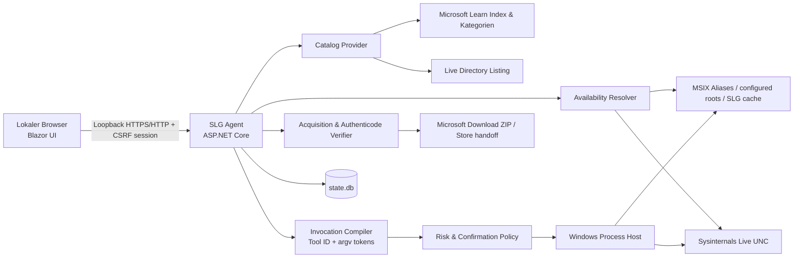

# Sysinternals Live GUI – Build-Plan

**Autor:** Manus AI  
**Planungsstand:** 14. Oktober 2026  
**Arbeitsname:** Sysinternals Live GUI (SLG)

## 1. Executive Summary, v1 Boundary und Entscheidungen mit hoher Wirkung

SLG wird ein **lokaler Windows-Agent mit browserbasierter GUI**. Er katalogisiert die offiziellen Sysinternals-Utilities, ermittelt je Tool und Zielhost die reale Nutzbarkeit und startet ausschließlich katalogisierte Sysinternals-Binaries mit strukturiert übergebenen Argumenten. Das UI läuft im Browser; die Programmausführung bleibt zwingend auf dem Windows-Host des Agents.

> **Wesentliche Korrektur der Ausgangsannahme:** Sysinternals Live ist nach Microsoft ein File Share für direkte UNC-Ausführung, kein Cloud- oder Browser-Remote-Execution-Service. Eine reine Webapp kann deshalb keine lokalen EXE-Dateien sicher starten. Der korrekte Entwurf ist ein lokaler Agent mit Web-GUI, nicht ein fernsteuernder Webdienst. [1] [2]

### V1 Boundary

**V1 liefert eine localhost-gebundene Web-GUI für Windows 10/11 bzw. unterstützte Windows-Server-Zielhosts.** Sie zeigt jeden aktuellen Eintrag des offiziellen Sysinternals-Indexes inklusive Plattformstatus, Kategorien und Suche; prüft Live-, lokale und Download-Optionen; ermöglicht für jede im Windows-Manifest hinterlegte Utility-Familie einen kontrollierten Start; und bietet strukturierte Parameterformulare beziehungsweise einen argumenttoken-basierten Advanced-Modus. Nicht enthalten sind Fernzugriff aus dem LAN/Internet, ein dauerhaft privilegierter Windows-Dienst, Umgehung von Application-Control-Richtlinien oder automatische Ausführung/Installation von Binaries ohne explizite Nutzeraktion.

### Entscheidungen mit hoher Wirkung

| ID | Entscheidung | Status | Begründung |
|---|---|---|---|
| DEC-1 | Browser-GUI plus lokaler Windows-Agent; Bindung in V1 ausschließlich an `127.0.0.1`. | Proposed | Erfüllt GUI-Portabilität und bewahrt den Ausführungskontext am Windows-Host. Kein Netzwerk-Remote-Code-Execution-Endpunkt entsteht. |
| DEC-2 | Agent auf **.NET 10 LTS / ASP.NET Core**, UI als Blazor-Web-App; SQLite nur für lokale Zustandsdaten. | Verified | .NET 10 ist LTS bis 14.11.2028 und vermeidet für V1 eine zweite JavaScript-Toolchain. [11] |
| DEC-3 | Kein Windows Service, keine globale Dauer-Elevation. Der Agent läuft im angemeldeten Benutzerkontext. | Proposed | Least Privilege; Risiken eines dauerhaft hochprivilegierten HTTP-Launchers werden vermieden. |
| DEC-4 | Keine Einbettung oder Redistribuierung von Sysinternals-Binaries. Abrufe erfolgen ausschließlich vom Nutzer ausgelöst direkt über Microsoft-Quellen. | Verified | Die Lizenz erlaubt Installation/Nutzung, beschränkt aber insbesondere Veröffentlichung, Weitergabe und kommerzielles Hosting. [6] |
| DEC-5 | Keine Shell-Evaluation. Argumente werden als strukturierter `argv`-Vektor an `ProcessStartInfo.ArgumentList` übergeben. | Proposed | Verhindert Command-Injection über `cmd.exe` oder PowerShell und erhält gültige Tool-Argumente. |
| DEC-6 | Katalog und Ausführungsmanifest werden getrennt versioniert. Neue Learn-Einträge erscheinen sofort im Katalog; erst nach Architektur-/Artefakt-/Risikoprüfung werden sie ausführbar. | Proposed | „Alle sichtbar“ bleibt vollständig, ohne unvalidierte Binaries freizuschalten. |

### Verifizierte externe Tatsachen

Microsoft dokumentiert für Live die Pfade `live.sysinternals.com/<toolname>` und `\\live.sysinternals.com\tools\<toolname>` und beschreibt das Angebot als File Share zur Ausführung ohne vorheriges ZIP-Download/Entpacken. [1] [2] Der Learn-Index ist die maßgebliche Liste von Tools, Versionen, Daten und Kurzbeschreibungen; die Kategorien sind File/Disk, Networking, Process, Security, System Information und Miscellaneous. [3] [12] [13] [14] [15] [16] [17]

Der lokale Store-Suite-Weg besitzt den Paketnamen `Microsoft.SysinternalsSuite_8wekyb3d8bbwe`; Binaries sind über App Execution Aliases im Profilpfad verfügbar. [5] Applikationssteuerung kann die Ausführung von EXE/PE-Dateien unabhängig von ihrer Endung beschränken; ein „Live erreichbar“-Status ist daher **keine** Zusage, dass ein Managed Host den Prozess erlaubt. [18] [19]

---

## 2. Idea Draft

### 2.1 Source record

- **Input form:** Gesprächsnachricht.
- **Source language:** Deutsch.
- **Source locator:** User-Nachricht vom 14.10.2026, 00:48 Uhr, Task `NolFHgPMaPtKqzz3Cj2735`.
- **Input snapshot:** „…Tools, unter live.sysinternals.com… direkt in ein laufendes Windows integrieren… Service … über eine Art GUI (darf auch eine webapp sein, so dass sie systemübergreifend funktionieren würde)… a) alle verfügbaren tools nach Kategorien und suchbar aufgelistet … b) … online ausgeführt … oder Download (evtl. Installation) erforderlich … c) … installiert bzw. online nutzbar … über GUI direkt benutzbar, am besten mit verfügbaren Parameterübergaben…“

### 2.2 Source synopsis

- **Working title:** Sysinternals Live GUI.
- **One-sentence concept:** Eine GUI verwaltet den offiziellen Sysinternals-Katalog und macht pro Windows-Host transparent, ob und wie jedes Tool sicher gestartet werden kann.
- **Problem or opportunity:** Sysinternals Live, ZIP-Downloads, Store-Installation, Architekturvarianten und CLI-Syntax sind heute getrennte, teils sicherheitskritische Wege.
- **Intended users and stakeholders:** Technisch versierte Windows-Administratoren, Support-/Forensik- und IT-Fachkräfte; sekundär die Organisation, deren Windows-Richtlinien gelten.
- **Primary outcome:** Ein lokaler, nachvollziehbarer Weg vom Auffinden eines Tools bis zu dessen kontrollierter Ausführung.
- **Explicit success signals:** Vollständiger Katalog, Kategorien/Suche, präziser Verfügbarkeitsstatus, direkter Start nutzbarer Tools, Parameterübergabe.
- **Explicit non-negotiables:** Bezug auf `live.sysinternals.com`; Integration in laufendes Windows; GUI.

### 2.3 Atomic source inventory

| Source ID | Atomic source statement | Evidence / locator | Interpretation notes |
|---|---|---|---|
| SRC-1 | Sysinternals-Tools von `live.sysinternals.com` sollen in ein laufendes Windows integrierbar sein. | User-Nachricht | Kein Anspruch auf Cloud-Ausführung ableitbar. |
| SRC-2 | Es soll eine GUI geben; eine Webapp ist zulässig und Systemübergreifbarkeit ist erwünscht. | User-Nachricht | „Darf auch“ ist Präferenz, nicht Bindung an eine gehostete Webapp. |
| SRC-3 | Alle verfügbaren Tools müssen nach Kategorien sichtbar und durchsuchbar sein. | User-Nachricht | „Verfügbar“ wird als offizieller Index plus Live-Artefaktstatus modelliert. |
| SRC-4 | Die GUI soll zwischen online direkt ausführbar und Download/Installation unterscheiden. | User-Nachricht | Der Zustand muss host- und architekturspezifisch sein. |
| SRC-5 | Bereits installierte oder online nutzbare Tools sollen über die GUI verwendbar sein, möglichst mit Parametern. | User-Nachricht | Direkte Verwendung umfasst GUI- und CLI-Tools mit unterschiedlichen Ausgabemodellen. |
| SRC-6 | Zuerst ist ein Plan mit dem Skill `idea-to-agent-plan` zu erstellen, danach beginnt die Arbeit. | User-Nachricht | Dieser Plan ist das explizit gewünschte Vorartefakt. |

### 2.4 Capability inventory

| ID | Capability / behavior | Evidence class | Confidence | Priority | Source IDs | Rationale / dependencies |
|---|---|---|---|---|---|---|
| CAP-1 | Vollständigen offiziellen Tool-Familienkatalog mit Metadaten anzeigen. | Source-backed | High | Must | SRC-3 | Seed aus Learn-Index, Live-Verzeichnis als Artefaktquelle. |
| CAP-2 | Mehrfachkategorien und Volltextsuche anbieten. | Source-backed | High | Must | SRC-3 | Kategorien sind im Learn-Angebot vorgegeben. |
| CAP-3 | Pro Tool Live-, lokale-, Download- und Einrichtungszustände darstellen. | Source-backed | High | Must | SRC-4 | Zustandsauflösung pro Host. |
| CAP-4 | Live-Binary über den dokumentierten UNC-Pfad starten. | Source-backed | High | Must | SRC-1, SRC-5 | Nur bei erfolgreicher Vorprüfung und Windows-Artefaktmapping. [1] |
| CAP-5 | Lokale Store-/Cache-/konfigurierte portable Installationen erkennen und starten. | Inferred | High | Must | SRC-4, SRC-5 | „Bereits installiert“ erfordert konkrete lokale Detektion. |
| CAP-6 | Offizielle Download- und optionale Store-Wege aus der GUI auslösen. | Source-backed | High | Must | SRC-4 | Kein Drittanbieter-Repository, keine Bundles. |
| CAP-7 | CLI-Parameter strukturiert erfassen, anzeigen und ohne Shell starten. | Source-backed | High | Must | SRC-5 | Pro Tool spezifische Syntax. |
| CAP-8 | Native GUI-Tools direkt im Benutzerdesktop starten und deren Startstatus zeigen. | Inferred | High | Must | SRC-5 | GUI-Tools schreiben meist nicht sinnvoll nach stdout. |
| CAP-9 | Sicherheitshinweise, Rechtebedarf, irreversible Wirkung und explizite Bestätigung anwenden. | Inferred | High | Must | SRC-1, SRC-5 | Mehrere Tools können löschen, rebooten, Prozesse beenden oder Dienste/Treiber einrichten. [7] [8] [9] |
| CAP-10 | Offizielle Hilfe, Lizenz und Quell-URLs pro Tool verlinken. | Inferred | High | Should | SRC-3, SRC-5 | Ermöglicht sichere Parameterentscheidung. |
| CAP-11 | Katalog-/Artefaktinformationen aktualisieren und Änderungen nachvollziehbar anzeigen. | Inferred | Medium | Should | SRC-3, SRC-4 | Microsoft stellt keinen hier verifizierten semantischen Katalog-API-Vertrag bereit. |
| CAP-12 | Lokale Läufe live anzeigen, abbrechen und auf Wunsch exportierbare Ausgabe bereitstellen. | Inferred | High | Should | SRC-5 | Notwendig für brauchbare CLI-Integration. |

### 2.5 Cross-cutting requirements

| ID | Requirement / constraint | Category | Evidence class | Priority | Source IDs | Notes |
|---|---|---|---|---|---|---|
| REQ-1 | Ausschließlich Microsoft-Sysinternals-Quellen dürfen Toolmetadaten und Binaries liefern. | Supply chain | Inferred | Must | SRC-1 | Learn, `live.sysinternals.com`, `download.sysinternals.com`, Microsoft Store. |
| REQ-2 | Katalogvollständigkeit darf nicht mit Live-Lauffähigkeit gleichgesetzt werden. | Semantik | Inferred | Must | SRC-3, SRC-4 | Plattform, Architektur, Richtlinie, Rechte und Artefakte sind getrennte Fakten. |
| REQ-3 | Das Produkt darf keine Binaries enthalten, spiegeln oder an Dritte verteilen. | Lizenz | Verified | Must | SRC-1, SRC-4 | Lizenzgrenze. [6] |
| REQ-4 | Ausführung und Parameterübergabe erfolgen ohne Shell-String-Auswertung. | Security | Inferred | Must | SRC-5 | Nur Manifest-ID plus validierte Argumenttokens. |
| REQ-5 | GUI ist browserbasiert und reagiert auf Desktop- und schmale Browserfenster. | UX / portability | Source-backed | Should | SRC-2 | Ausführung bleibt Windows-spezifisch. |
| REQ-6 | Standardmäßig keine Credentials, Dumps, Konsolenausgaben oder Toolartefakte dauerhaft speichern. | Privacy | Inferred | Must | SRC-5 | Sysinternals-Ausgaben können sensible Informationen enthalten. [6] |
| REQ-7 | Kein Versuch, UAC, AppLocker, App Control, Smart App Control oder Unternehmensrichtlinien zu umgehen. | Security / operations | Inferred | Must | SRC-1 | Richtlinienblockaden werden transparent gemeldet. [18] [19] |
| REQ-8 | Statusprüfungen dürfen keine zustandsändernden Tool-Aktionen ausführen. | Safety | Inferred | Must | SRC-4, SRC-5 | Kein automatisches `-?` als Probe und keine EULA-Akzeptanz bei Scan. |
| REQ-9 | Die Bedienoberfläche und Fehlertexte sind auf Deutsch; offizielle Toolnamen/Syntax bleiben unverändert. | Localization | Inferred | Should | SRC-2 | Deutsche Standardoberfläche ohne Übersetzung technischer Argumente. |

### 2.6 Actors and permissions

| Actor / role | Goals | Allowed actions | Restricted actions | Source IDs |
|---|---|---|---|---|
| Lokaler Operator | Tools finden, prüfen, laden und starten. | Lesen, Download anstoßen, nicht-kritisch starten, Ausgaben ansehen/exportieren. | Keine automatische UAC- oder Lizenzannahme; kritische Aktionen erst nach Bestätigung. | SRC-1–SRC-5 |
| Lokaler Administrator | Administrative Sysinternals-Aktionen gezielt ausführen. | UAC bestätigen; dienst-/treiberbezogene oder systemverändernde Tools gezielt starten. | Keine Umgehung von Richtlinien; kein persistentes Credential-Depot. | SRC-1, SRC-5 |
| Organisatorische Sicherheitsrichtlinie | Codeausführung steuern. | Ausführung erlauben/blockieren. | Nicht durch SLG veränderbar. | SRC-1 |

### 2.7 Domain model, states and workflows

- **Core entities and data:** `ToolFamily` (z. B. ProcDump), `Artifact` (konkrete EXE/Architektur/Quelle), `Package` (ZIP/MSIX-Link), `InvocationPreset`, `ArgumentToken`, `AvailabilitySnapshot`, `RunSession`, `ConfirmationRecord` und `CatalogRevision`.
- **Availability states:** `ready-local`, `ready-live`, `download-available`, `store-available`, `needs-setup`, `blocked-by-policy-or-permission`, `unsupported-platform-or-architecture`, `unverified`, `unknown-error`. Mehrere Zustände können zugleich existieren; die UI zeigt einen bevorzugten, aber erklärbaren Pfad.
- **Primary workflow:** Operator sucht Tool → öffnet Detailansicht → Agent löst lokale/Live/Download-Optionen auf → Operator wählt Quelle und Parametersatz → UI zeigt Befehlsvorschau, Nebenwirkungen und Rechtebedarf → nötige Bestätigung → Agent startet den Prozess → UI zeigt PID, Zustand, Ausgabe oder „native GUI gestartet“.
- **Alternate workflows:** Store-Suite erkannt → Alias wird verwendet; Live über SMB nicht erreichbar → offizieller ZIP-Download angeboten; Tool ist GUI-only → Fensterstart statt Terminalstream; Tool ist Linux/macOS-only → katalogisiert, aber am Windows-Host nicht startbar.
- **Failure and recovery workflows:** Download-/Signaturfehler → Staging-Datei verwerfen, nicht starten; Live-Zugriffsfehler → klarer Status mit lokalem Fallback; Richtlinienblock → Originalfehler mit Hilfelink, keine Umgehung; abgebrochener CLI-Lauf → Prozessbaum kontrolliert beenden, als „abgebrochen“ markieren; unbekannter Prozessstatus → erneut prüfen, keine automatische Wiederholung.

### 2.8 Integrations and interfaces

| Interface / dependency | Direction | Data exchanged | Trigger | Authentication / trust boundary | Failure behavior | Mandatory? | Source IDs |
|---|---|---|---|---|---|---|---|
| Microsoft Learn Index/Kategorien | inbound | Toolnamen, Version, Datum, Kurzbeschreibung, Doku-URL, Kategorien | Seed/Refresh | HTTPS, Microsoft-Quelle | Letzte signierte/validierte Katalogrevision read-only verwenden | Yes | SRC-3 |
| Sysinternals Live | inbound / execution path | UNC-EXE-Artefakte | Vorprüfung/Start | SMB-Share, Windows-Policy | `ready-live` entfällt; Download-/lokale Alternative | Yes | SRC-1, SRC-4 |
| `download.sysinternals.com` | inbound | Offizielle ZIP-Pakete | Nutzerdownload | HTTPS, Authenticode nach Extraktion | Datei verwerfen, keine Ausführung | Yes | SRC-4 |
| Microsoft Store | outbound handoff | Produktseite/Installationshandlung | Nutzerwahl „Store“ | Store/UAC/Account außerhalb SLG | Handoff mit nachvollziehbarem Rückkehrstatus | No | SRC-4 |
| Windows Process API | local outbound | Dateipfad, argv, cwd, stdout/stderr | bestätigter Start | Benutzerkontext, optional UAC außerhalb V1-Capture | Startfehler statusisiert | Yes | SRC-5 |
| Windows Authenticode/WinVerifyTrust | local inbound | Signaturstatus, Signierer, Fehlercode | lokales Cache- und optional Live-Validieren | Windows Trust Store | Nicht vertrauenswürdig → nicht startbar | Yes | SRC-4, SRC-5 |

### 2.9 Constraints, preferences and prohibitions

- **Hard constraints:** Windows-Zielhost; offizielle Sysinternals-Quellen; vollständige Katalogansicht; kategorisierbar, suchbar und direkt nutzbar; Lizenzkonformität.
- **Soft preferences:** Browser-/Web-GUI und Systemübergreifbarkeit der Bedienung.
- **Prohibitions:** Keine Drittquellen, keine Binary-Redistribution, keine Policy-Bypässe, keine implizite EULA-Akzeptanz, kein beliebiger lokaler EXE-Starter, keine Shell-Interpolation.

### 2.10 Conflicts and ambiguities

| ID | Conflicting or ambiguous statements | Source IDs | Impact | Reversibility | Proposed handling |
|---|---|---|---|---|---|
| CON-1 | „Webapp/systemübergreifend“ steht einer gewünschten Ausführung von Windows-EXEs gegenüber. | SRC-1, SRC-2, SRC-5 | High | Easy | V1: browserbasiertes UI, lokaler Windows-Agent; Ausführung außerhalb Windows explizit `unsupported`. |
| CON-2 | „Alle Tools direkt nutzbar“ umfasst auch destruktive, privilegierte und persistente Utilities. | SRC-3, SRC-5 | High | Easy | Keine Funktion entfernen; Risikoklasse, genaue Vorschau, zusätzliche Bestätigung und kein Auto-Start. |
| CON-3 | „Online ausführbar“ kann fälschlich als browserseitig/ohne Netzrestriktion verstanden werden. | SRC-1, SRC-4 | Medium | Easy | Begriff in UI präzisieren: „Direkt vom Sysinternals-Live-UNC-Pfad auf diesem Host startbar“. |

### 2.11 Challenged proposals and corrections

| Source IDs | User-proposed means | Concrete problem or inferiority | Likely consequence | Better alternative | Decision / user confirmation |
|---|---|---|---|---|---|
| SRC-2, SRC-5 | Reine Webapp als systemübergreifende Ausführungsoberfläche. | Browser dürfen beliebige lokale Windows-EXEs nicht sicher starten; ein webexponierter Ausführungsdienst wäre zusätzlich ein RCE-Risiko. | Anforderung c wäre nicht zuverlässig erfüllbar oder würde unsichere Architektur erfordern. | Loopback-Web-GUI mit lokalem Windows-Agent; später optional separat gesicherter Remote-Relay. | DEC-1 Proposed, reversible. |
| SRC-5 | Direkte Benutzbarkeit ohne weitere Einschränkung. | PsExec, Sysmon, SDelete, ProcDump, NotMyFault und ähnliche Tools können Credentials, Prozesse, Daten, Dienste oder den Systemzustand betreffen. | Datenverlust, Persistenz, Datenschutz- oder Sicherheitsvorfälle. | Direkte Nutzung mit manifestgebundenen Argumenten, sichtbarer Wirkungsklasse und bestätigtem Start. | DEC-3/DEC-5 Proposed. |

### 2.12 Assumption and decision register

> Assumption [ASM-1]: V1 richtet sich an einen interaktiven Einzeloperator auf demselben Windows-Host wie der Agent.
>
> **Reason:** Kein Fernzugriff wurde explizit gefordert; localhost ist die sichere reversible Standardgrenze.
>
> **Evidence:** SRC-1, SRC-2.
>
> **Impact if wrong:** Multi-Host-Fernsteuerung benötigt ein neues Authentifizierungs-, TLS- und Consent-Modell.
>
> **Validation / reversal path:** Separates ADR und Sicherheits-Spike vor einem optionalen Remote-Release.

> Assumption [ASM-2]: Die Initialversion unterstützt Windows-Toolausführung; katalogisierte Linux-/macOS-Einträge werden sichtbar, aber nicht durch einen Windows-Agenten gestartet.
>
> **Reason:** Live veröffentlicht überwiegend Windows-EXE-Artefakte; einzelne offizielle Tools besitzen separate Linux/macOS-Quellen. [3] [4] [7] [9]
>
> **Impact if wrong:** Ein echter Multi-OS-Executor wird ein eigenes Releaseziel.
>
> **Validation / reversal path:** Adapter-Interface und Plattformmatrix von Beginn an; Linux/macOS-Agent später ergänzbar.

> Assumption [ASM-3]: Die Store-Suite ist ein optionaler lokaler Fundort, nicht der einzige Installationsweg.
>
> **Reason:** Microsoft bietet sowohl MSIX als auch ZIP-Suite/Einzelpakete und Live an. [3] [5]
>
> **Impact if wrong:** In gesperrten Store-Umgebungen bleibt offizieller ZIP-Download verfügbar.
>
> **Validation / reversal path:** Store-Erkennung ist austauschbarer Resolver.

> Assumption [ASM-4]: Credentials werden nie in UI, Logs, SQLite, Launch-Historie oder URL gespeichert.
>
> **Reason:** PsExec kann interaktive Zugangsdaten verlangen, während Sysinternals-Ausgaben sensible Daten enthalten können. [6] [8]
>
> **Impact if wrong:** Ein Credential-Vault wäre ein sicherheitsrelevantes, explizit zu beauftragendes Teilprodukt.
>
> **Validation / reversal path:** V1 erlaubt credential-bezogene Aufrufe nur mit interaktiver nativer Eingabe und redigiert sie in Vorschau/Logs.

> Assumption [ASM-5]: Parameterwizards werden nur für fachlich geprüfte Tools bereitgestellt; jeder CLI-Eintrag erhält mindestens einen Token-Editor und einen Link zur offiziellen Syntax.
>
> **Reason:** Die Syntax und Nebenwirkungen sind tool- und versionsspezifisch. [7] [8] [9]
>
> **Impact if wrong:** Vollständige Formularmodellierung aller Optionen verlängert V1 unverhältnismäßig.
>
> **Validation / reversal path:** Schema pro Tool ist versioniert erweiterbar, ohne Launcher/API zu ändern.

| Decision ID | Decision | Status | Basis | Alternatives retained / rejected | Revisit trigger |
|---|---|---|---|---|---|
| DEC-1 | Loopback-Web-GUI + Windows-Agent. | Proposed | CON-1, ASM-1 | Tauri-Desktop; öffentlicher Webservice verworfen für V1. | Expliziter Multi-Host-Use-Case. |
| DEC-2 | .NET 10 LTS, ASP.NET Core, Blazor, SQLite. | Verified | Laufzeit-Support [11] | React/Node; native WPF. | Framework-EOL, UI-Komplexität oder Linux-Agent. |
| DEC-3 | Kein persistenter privilegierter Dienst. | Proposed | CON-2 | Elevation-Broker als späteres, separat auditiertes Feature. | Bedarf an integrierter Admin-Output-Capture. |
| DEC-4 | Quellengetrenntes Katalog- und Ausführungsmanifest. | Proposed | REQ-1, REQ-2 | Live-Directory-only verworfen, da Kategorien/Doku fehlen. | Microsoft veröffentlicht stabile Katalog-API. |
| DEC-5 | Strukturierte Argumenttokens, keine Shell. | Proposed | REQ-4 | Freitext-Commandline nur intern mit sicherem Tokenizer; keine Shell. | Keine Änderung ohne Sicherheitsreview. |
| DEC-6 | Keine Binary-Bundles, On-demand-Abruf nur von Microsoft. | Verified | REQ-3, [6] | App-beigefügte Suite verworfen. | Lizenz-/Quellenmodell ändert sich. |

### 2.13 Scope proposal

- **v1 Must:** `CAP-1` bis `CAP-9`, `REQ-1` bis `REQ-8`; vollständiger sichtbarer Katalog; Live/local/download-Zustandsauflösung; Start jeder validierten Windows-Toolfamilie; sichere Argumenttokens und Risikogates.
- **v1 Should:** `CAP-10` bis `CAP-12`, `REQ-9`; deutscher UI-Text, Dokumentlinks, Katalog-Refresh, Laufexport.
- **Deferred backlog / Could:** Signierter Updater; optionaler audited UAC-Output-Broker; Tailscale/mTLS-Remote-Bedienung; Linux-/macOS-Ausführungsadapter für dafür veröffentlichte Tools; Teams-/Profilverwaltung; vorkonfigurierte Sysmon-Profile.
- **Explicitly out of scope:** Policy-Bypass, beliebige EXE- oder Script-Ausführung, Credential-Speicherung, SaaS-Hosting, Sysinternals-Binary-Redistribution, automatische Hintergrundeinrichtung von Sysmon/Ctrl2Cap/Autologon oder vergleichbaren zustandsverändernden Tools.
- **v1 cut line:** V1 endet bei kontrollierter lokaler Windows-Ausführung aus einem offiziellen, geprüften Manifest über eine localhost-Web-GUI; sichere Fernsteuerung und native Nicht-Windows-Ausführung beginnen erst danach.

### 2.14 Clarification gate

**None; remaining gaps are handled as explicit assumptions, configurable choices, or early validation spikes.** Der lokale-only Standard vermeidet die nicht angeforderte und sicherheitsrelevante Entscheidung über Fernzugriff.

### 2.15 Extraction coverage audit

- source statements inventoried: **6**;
- source-backed capabilities/requirements: **7**;
- inferred capabilities/requirements: **14**;
- unresolved conflicts: **0**;
- excluded source items with reasons: **0**;
- known omissions: **None**.

---

## 3. Product Requirements Document (PRD)

### 3.1 Product definition

- **Working product name:** Sysinternals Live GUI.
- **One-sentence pitch:** Eine lokale Weboberfläche, die Sysinternals-Tools auffindbar, hostbezogen verfügbar und kontrolliert ausführbar macht.
- **Problem statement:** Die offizielle Toollandschaft verteilt sich auf Learn-Dokumentation, Live-Share, ZIP-Pakete und Store-Aliase. Der Operator muss Quelle, Architektur, Rechte, Parameter und Wirkung heute manuell zusammenführen.
- **Primary value proposition:** Ein ehrlicher Status pro Tool und eine kontrollierte Startstrecke ohne Shell-Interpolation oder unklare Herkunft.
- **Target platform(s) and environment(s):** Windows-Agent auf Windows 10/11 und unterstützten Serverversionen; UI in aktuellen lokalen Browsern; katalogisiert zusätzlich offizielle Nicht-Windows-Tools ohne deren Ausführung in V1.
- **Expected users and rough operating scale:** Ein Operator/Host in V1; keine Mehrmandanten- oder SaaS-Annahme.
- **v1 cut line:** Wie in Abschnitt 2.13 definiert.

### 3.2 Goals, non-goals and release scope

- **Goals:** Katalogisieren, suchen, statusisieren, herunterladbar machen und kontrolliert starten.
- **Non-goals:** Sysinternals selbst nachbauen; Unternehmensrichtlinien verändern; unbeschränkte Remote-Shell bereitstellen; eierlegendes Sysadmin-Dashboard sein.
- **v1 Must / Should:** Entspricht `CAP-1`–`CAP-12` und `REQ-1`–`REQ-9`.
- **Deferred backlog / Could:** Entspricht Abschnitt 2.13.
- **Out of scope:** Entspricht Abschnitt 2.13; die Gründe sind Lizenz, Sicherheitsgrenze und fehlende Quelle in SRC-1–SRC-5.

### 3.3 Actors, personas and permissions

Der lokale Operator ist alleiniger V1-Aktor. Der Agent fordert bei administrativen Aktionen die normale Windows-Berechtigungsgrenze an, aber hinterlegt keine Credentials. Die UI unterscheidet Operatoraktionen nach Risikoklasse, nicht nach erfundenen Produktrollen.

| Aktion | Operator | Lokaler Administrator | Organisationsrichtlinie |
|---|---:|---:|---:|
| Katalog ansehen/suchen | erlaubt | erlaubt | beeinflusst nicht |
| Live/local prüfen | erlaubt | erlaubt | kann Ergebnis indirekt beeinflussen |
| Offiziellen Download anstoßen | erlaubt | erlaubt | kann blockieren |
| Nicht-kritischen Prozess starten | erlaubt | erlaubt | kann blockieren |
| Hohe Risikoklasse starten | bestätigungspflichtig | bestätigungspflichtig | kann blockieren |
| Rechte/Elevation umgehen | verboten | verboten | nicht veränderbar |

### 3.4 User journeys and use cases

**US-1 — Tool finden und einordnen (`CAP-1`, `CAP-2`, `CAP-10`):** Als Operator möchte ich „ProcDump“ suchen und seine Kategorien, Version, Doku, Plattformen und Wirkung sehen, damit ich ein passendes Tool wählen kann. Vorbedingung ist ein geladener Katalog. Bei leerem Suchergebnis bietet die UI aktive Filter an; bei stale Katalog wird dessen Alter angezeigt.

**US-2 — Ausführungsweg verstehen (`CAP-3`, `CAP-5`, `CAP-6`):** Als Operator möchte ich erkennen, ob ein Tool lokal bereit, über Live erreichbar, herunterladbar oder erst einzurichten ist. Der Agent prüft konkret Architektur, lokale Alias-/Cache-/Root-Funde und den Live-Artefaktpfad; Fehler werden mit Ursache und Fallback angezeigt.

**US-3 — CLI kontrolliert starten (`CAP-4`, `CAP-7`, `CAP-12`):** Als Operator möchte ich `sigcheck` mit dokumentierten Argumenttokens starten und die Ausgabe sehen. Nach Auswahl des Quellpfads validiert der Agent das Manifest und jeden Token, zeigt den resultierenden `argv` an und startet ohne Shell. Bei Toolabbruch kann ich nur die von SLG gestartete Session beenden.

**US-4 — Native GUI starten (`CAP-8`, `CAP-9`):** Als Operator möchte ich Process Explorer direkt öffnen. Die UI zeigt Quelle, Prozesspfad, PID und den Hinweis, dass Interaktion im nativen Fenster stattfindet. Bei einem Tool mit systemverändernder Wirkung verlangt die UI eine gezielte Bestätigung mit konkreter Aktion.

**US-5 — Offiziell lokal verfügbar machen (`CAP-6`, `CAP-9`):** Als Operator möchte ich ein fehlendes Tool als offizielles Paket beziehen. Vor Download erklärt die UI Quelle, Paketinhalt, Lizenzlink und Zielverzeichnis. Nach Download, Extraktion und Signaturprüfung wird nur die explizite Artefaktdatei dem lokalen Cache zugeordnet; bei Verifikationsfehler ist kein Start möglich.

### 3.5 Functional requirements

| ID | Requirement | Priority | Evidence class | Origins | Preconditions / input | Behavior | Output / state change | Failure behavior | Acceptance IDs |
|---|---|---|---|---|---|---|---|---|---|
| FR-1 | Der Agent muss einen versionierten Katalog aller Einträge des offiziellen Sysinternals-Indexes führen. | Must | Source-backed | CAP-1, SRC-3 | Seed-Katalog | Einträge normalisieren, ohne unbestätigte Binaries startbar zu machen. | `CatalogRevision`, Toolkarten | Alte valide Revision bleibt sichtbar. | AC-1 |
| FR-2 | Die UI muss Mehrfachkategorien und Volltextsuche auf Name, Alias, Kurzbeschreibung und Tags bieten. | Must | Source-backed | CAP-2, SRC-3 | Suchtext/Filter | Clientseitig filtern, Trefferzahl und leeren Zustand anzeigen. | Gefilterte Toolkarten | Keine Fehlermeldung bei Nulltreffern. | AC-2 |
| FR-3 | Die Detailansicht muss Quelle, Version, Doku, Plattform, Kategorien, Wirkungsklasse und Artefakte zeigen. | Must | Inferred | CAP-1, CAP-10 | Tool-ID | Manifest- und Katalogdaten verbinden. | Vollständige Detailansicht | Nicht verfügbare Felder als „nicht verifiziert“ kennzeichnen. | AC-1, AC-3 |
| FR-4 | Der Agent muss für jedes Tool die Zustände lokal, Live, Download, Store, Setup, Policy/Permission und unsupported getrennt auflösen. | Must | Source-backed | CAP-3, REQ-2 | Tool-ID, Hostprofil | Resolver evaluieren ohne Toolstart. | `AvailabilitySnapshot` mit Evidenz | Ursachen/Fallbacks statt pauschalem „nicht verfügbar“. | AC-3 |
| FR-5 | Der Agent darf einen Live-Start nur mit einem im Manifest hinterlegten UNC-Artefaktpfad und positiver Vorprüfung durchführen. | Must | Source-backed | CAP-4, REQ-1 | Tool-ID, Architektur, argv | EXE direkt per UNC starten. | `RunSession` | SMB/Policy-Fehler klar melden; lokales Fallback. | AC-4 |
| FR-6 | Der Agent muss Store-Aliase, verwalteten SLG-Cache und explizit konfigurierte portable Root-Verzeichnisse erkennen. | Must | Inferred | CAP-5 | Hostprofil | Datei, Architektur, Version und Signatur prüfen. | `ready-local` oder begründeter Fehler | Fund ohne valide Signatur ist nicht startbar. | AC-5 |
| FR-7 | Der Agent muss offizielle ZIP-Pakete in ein staging-Verzeichnis laden, gezielt extrahieren, signaturprüfen und erst danach in den lokalen Cache übernehmen. | Must | Source-backed | CAP-6, REQ-3 | Paket-ID, Zielartefakt | Origin fest prüfen; atomar verschieben. | `ready-local`; Cache-Record | Staging bereinigen/quarantänisieren; kein Start. | AC-6 |
| FR-8 | Die UI muss für jede CLI-Toolfamilie einen tokenisierten Advanced-Parametereditor mit offizieller Dokumentationsverlinkung anbieten. | Must | Source-backed | CAP-7, ASM-5 | Array aus Argumenttokens | Token einzeln validieren und Vorschau bilden. | Validierungsresultat, `argv`-Vorschau | Illegale Tokens/Regelkonflikte blockieren Start. | AC-7 |
| FR-9 | Die UI muss für priorisierte Tools geprüfte Formulare und gespeicherte, nicht-sensitive Presets anbieten. | Should | Inferred | CAP-7 | Tool-spezifische Formdaten | Schema in Argumenttokens kompilieren. | Vorschau, optionales Preset | Schemafehler ohne Ausführung melden. | AC-7 |
| FR-10 | Der Agent muss native GUI-Tools im interaktiven Nutzerkontext starten und den Prozessstart dokumentieren. | Must | Inferred | CAP-8 | Validiertes Invocation-Objekt | GUI-Prozess ohne stdout-Umleitung starten. | PID, Zustand, Quelle | Windows-Startfehler anzeigen. | AC-8 |
| FR-11 | Der Agent muss CLI-stdout/stderr mit Zeitstempel an die UI streamen und die gestartete Session abbrechbar machen. | Should | Inferred | CAP-12 | Laufende CLI-Session | Bounded In-Memory-Buffer und SignalR-Stream verwenden. | Laufansicht/Export auf Nutzerwunsch | Abbruch- und Ausgabefehler getrennt markieren. | AC-9 |
| FR-12 | Der Agent muss pro Invocation Risiko, Rechtebedarf, Persistenz und sensible Ausgaben bewerten und erforderliche Bestätigungen erzwingen. | Must | Inferred | CAP-9 | Tool-ID, Tokens, Quellmodus | Manifestregeln auswerten; genaue Konsequenz zeigen. | ConfirmationRecord ohne Geheimnisse | Keine Bestätigung → kein Start. | AC-10 |
| FR-13 | Der Agent darf keine EULA automatisch annehmen; bei Tools mit dokumentiertem EULA-Parameter muss die Wahl sichtbar bleiben. | Must | Inferred | REQ-8 | Tool/Invocation | Default ohne `-accepteula`; explizite bestätigte Wahl als Token. | Transparente EULA-Übergabe | Toolinteraktion bleibt beim Nutzer. | AC-10 |
| FR-14 | Die UI muss verständliche Fehler für Live-SMB, Signatur, Policy, Architektur, Rechte, Download und Toolprozess liefern. | Must | Inferred | CAP-3, REQ-7 | Fehlerquelle | Fehler klassifizieren und Microsoft-Doku verlinken, soweit vorhanden. | Reproduzierbarer Fehlerstatus | Keine automatische Policy-Änderung/Wiederholung. | AC-11 |
| FR-15 | Ein Operator muss die Katalogrevision und den Statusrefresh manuell auslösen und Unterschiede prüfen können. | Should | Inferred | CAP-11 | Refresh-Aktion | Neue Daten validieren/diffen; bei Parserbruch letzte Revision behalten. | Neue oder beibehaltene Revision | Keine Teilrevision wird aktiv. | AC-12 |

### 3.6 Domain and data requirements

- `catalog.json` ist versionskontrollierte, generierte Produktressource. Es enthält nur Metadaten, Quellen und Kategorien, keine Binaries.
- `execution-manifest.json` besitzt pro Windows-Toolfamilie explizite Architektur-Artefakte, offizielle Paketquelle, UI-Kind, Risikoregeln, EULA- und Parameter-Schema. Es darf nur nach Review aktualisiert werden.
- `state.db` liegt benutzerlokal. Es enthält Cache-Pfade, Signatur-/Versionsergebnisse, nicht-sensitive Presets, Revisionen und kurze Run-Metadaten. Standardretention für volatile Ausgaben ist Prozessspeicher; Export ist explizit und pfadgeprüft.
- Passwörter, Parameterwerte mit Geheimnissemantik, Dumps, Sysmon-/Procmon-Aufzeichnungen und volle Konsolenausgaben werden nicht persistiert. URLs enthalten nie Argumente oder Tokens.
- Cache-Upgrade erfolgt atomar: `staging` → Verifikation → versionsierter Cache → Datenbank-Commit. Ein nicht mehr referenziertes Cache-Artefakt wird nur über eine separate, bestätigte Reinigungsfunktion behandelt.

### 3.7 Interfaces and integrations

Die lokale API erhält den Präfix `/api/v1` und akzeptiert/erzeugt JSON. Der Browser erhält beim lokalen Start eine zufällige Bootstrap-Session; Host-, Origin- und Anti-CSRF-Prüfungen erlauben ausschließlich den Loopback-UI-Ursprung.

| Endpoint / contract | Owner | Input | Output | Failure / idempotency |
|---|---|---|---|---|
| `GET /api/v1/health` | Agent | none | Agentversion, bind mode, Katalogrevision | Keine Seiteneffekte. |
| `GET /api/v1/tools` | Catalog API | Suche, Kategorie, Plattform, Statusfilter | paginierte Toolsummarys | Leere Liste ist gültig. |
| `GET /api/v1/tools/{id}` | Catalog API | kanonische Tool-ID | Details, Quell-/Doku-Links | Unbekannte ID: 404. |
| `POST /api/v1/tools/{id}/availability:refresh` | Resolver | Tool-ID | evidenzierter Snapshot | Kein Toolstart; wiederholbar. |
| `POST /api/v1/packages/{id}/acquire` | Acquisition | Paket-ID, bestätigter Kontext | Job-ID, Fortschritt | Per Paket/Version serialisieren. |
| `POST /api/v1/invocations:preview` | Invocation compiler | Tool-ID, Quelle, Argumenttokens | Pfad, argv, Risiken, Bestätigungen | Nie starten; Validierung 422. |
| `POST /api/v1/invocations:start` | Launcher | bestätigte Preview-ID | RunSession-ID/PID | Idempotency-Key verhindert Doppelstart. |
| `GET /api/v1/runs/{id}/stream` | Run stream | RunSession-ID | stdout/stderr/Lifecycle-Ereignisse | Nur eigene Agent-Session; bounded buffer. |
| `POST /api/v1/runs/{id}:cancel` | Launcher | RunSession-ID | Endzustand | Nur SLG-eigene aktive Kindprozesse. |

### 3.8 UX, accessibility and interaction rules

- Startseite: Statusbanner für Agent/Live/Katalog, danach Kategorien, Suche und filterbare Toolkarten.
- Toolkarte: Toolname, Plattformbadge, Kategorien, bevorzugter Status und Wirkungsklasse. Keine implizite „sicher“-Aussage.
- Detailseite: „Überblick“, „Verfügbarkeit“, „Ausführen“, „Dokumentation“, „Paket/Quellen“ und „Risiken“. Befehlsvorschau zeigt ausführbaren Pfad, Quelle, Arbeitsverzeichnis, Argumenttokens und erwartete Nebenwirkung.
- Buttontexte unterscheiden „Live starten“, „lokal starten“, „Paket laden“, „Im Microsoft Store öffnen“, „Einrichtung prüfen“ und „nicht unterstützt“.
- Kritische Aktionen fordern eine Wiederholung des Toolnamens oder einen eindeutigen Bestätigungssatz; der Dialog benennt konkrete Effektklasse wie „schreibt Dump“, „beendet Prozess“, „löscht Daten“, „ändert Startverhalten“, „installiert Dienst/Treiber“, „rebootet“ oder „führt remote aus“.
- Vollständig tastaturbedienbar; sichtbarer Fokus, semantische Labels, ARIA-Live-Bereich für Run-Events, ausreichender Kontrast und kein farballeiniger Status.
- Deutsche Beschriftungen, aber niemals übersetzte Sysinternals-Flags, Befehlsnamen oder Windows-Pfade.

### 3.9 Non-functional requirements

| ID | Requirement | Operating condition / target | Validation method | Origins |
|---|---|---|---|---|
| NFR-1 | Supply-Chain-Vertrauen | Nur hinterlegte Microsoft-Origin-Hosts, Signaturvalidierung vor Cache-Start. | Fake-URL-/ungültige-Signatur-Tests. | REQ-1, REQ-3 |
| NFR-2 | Least Privilege | Agent ohne Adminrechte; Elevation nie unsichtbar und nie dauerhaft. | Token-/UAC-Integrationstest. | DEC-3, REQ-7 |
| NFR-3 | Command-Injection-Schutz | Kein Endpunkt akzeptiert ausführbare Shellstrings oder beliebige EXE-Pfade. | Negative API-/Property-Tests. | REQ-4 |
| NFR-4 | Datenschutz | Keine Persistenz von Credentials, Toolausgabe oder Forensikdaten standardmäßig. | DB-, Log- und Exporttests. | REQ-6 |
| NFR-5 | Degradierter Betrieb | Lokaler Katalog und lokaler Cache bleiben ohne Live/Internet nutzbar. | Offline-Integrationstest. | CAP-3, CAP-5 |
| NFR-6 | Transparenz | Jeder Status enthält Quelle, Prüfzeit, Evidenz und Fallback. | UI-/API-Contract-Test. | REQ-2 |
| NFR-7 | Kompatibilität | UI im lokalen aktuellen Chromium/Firefox/Edge; Agent nur Windows in V1, x64/ARM64 nach Artefaktmatrix. | Browsermatrix und Windows-VM-Test. | ASM-2, REQ-5 |
| NFR-8 | Wartbarkeit | Katalogschema, Execution-Manifest und Risiko-Policy besitzen JSON-Schema, Tests und Versionsnummer. | Schema-/Contract-Test in CI. | DEC-4 |
| NFR-9 | Observability | Lokale, redigierte Agentdiagnostik mit Korrelations-ID, aber ohne Credential-/Tokeninhalte. | Log-Redaktionstest. | REQ-6 |

### 3.10 Edge cases and failure model

| Scenario | Required behavior | Recovery |
|---|---|---|
| Live-SMB nicht erreichbar | `ready-live` nicht behaupten, genaue Netzwerk-/Access-Ursache zeigen. | Lokaler Cache, ZIP oder Store anbieten. |
| Live erreichbar, EXE durch Policy blockiert | Ausführungsfehler als Policy/Windows-Code abbilden, keine Umgehung. | Administrator-/Policy-Hinweis; lokalen alternativen Pfad zeigen. |
| Windows-Architektur ohne Artefaktmapping | Kein generiertes Dateinamensraten. | `unsupported` bis Manifest ergänzt wird. |
| Paketdownload unterbrochen oder ZIP defekt | Kein Cache-Commit und kein Start. | Staging löschen/quarantänisieren, erneut starten lassen. |
| Signatur ungültig/unbekannt | Start blockieren und Signaturdaten ausgeben. | Paket erneut direkt von Microsoft abrufen oder melden. |
| Tool hat GUI, aber keine Console | Nur Start-/PID-Status; kein scheinbarer Terminalstream. | Natives Fenster verwenden. |
| Prozess startet mit langen/fortlaufenden Daten | Stream begrenzen, UI nicht blockieren, optional explizit exportieren. | Ältere Eventfenster verwerfen mit Zähler. |
| Start mit `-accepteula` | Nur nach deutlich benannter Bestätigung als einzelner Token. | Token entfernen und erneut previewen. |
| PsExec/Credential-Parameter | Keine Passwortablage und Redaktion der Anzeige. | Interaktive native Eingabe oder tool-externe Authentifizierung. |
| Sysmon-/Treiber-/Dienstaktion | Persistenz markieren, zusätzliche Bestätigung; kein stiller Start. | Dokumentierter Uninstall-/Reconfigure-Hinweis. [9] |
| SDelete/NotMyFault/PsShutdown | Hohe/critische Wirkung, zweistufige Bestätigung. | Kein automatische Rollback-Versprechen. |

### 3.11 Constraints, assumptions and decisions

Die Hard Constraints sind `REQ-1` bis `REQ-4` und `REQ-7` bis `REQ-8`. Die weiche Präferenz ist die browserbasierte, deutschsprachige UI (`REQ-5`, `REQ-9`). Die Annahmen `ASM-1` bis `ASM-5` und Entscheidungen `DEC-1` bis `DEC-6` gelten unverändert.

Die Entscheidung gegen eine reine Fernwebapp korrigiert die technisch nicht tragfähige Gleichsetzung „Web-GUI = lokale EXE-Ausführung“. Diese Korrektur verändert nicht das Nutzerziel, sondern verhindert eine unsichere Ausführungsschnittstelle.

### 3.12 Acceptance criteria and v1 definition of done

| ID | Observable acceptance criterion |
|---|---|
| AC-1 | Given eine gültige Katalogrevision, when der Operator die Toolübersicht öffnet, then enthält sie jeden normalisierten Toolfamilien-Eintrag des referenzierten Learn-Indexes samt Quelle, Kategorien und Plattformmarkierung. |
| AC-2 | Given beliebige kombinierte Kategorie- und Suchfilter, when der Operator filtert, then werden nur passende Toolkarten angezeigt und ein leerer Zustand ist verständlich. |
| AC-3 | Given ein ausgewähltes Tool, when Verfügbarkeit aktualisiert wird, then zeigt die UI getrennte Evidenz für Live, lokale Quellen, Paket/Store, Architektur, Rechte und Fehler/Fallback. |
| AC-4 | Given ein Windows-Live-Artefakt mit positiver Vorprüfung, when der Operator den bestätigten Live-Start ausführt, then startet genau der manifestierte UNC-Pfad mit dem previewten `argv` und eine RunSession entsteht. |
| AC-5 | Given eine Store-Alias-, Cache- oder configured-root-Kopie, when sie gefunden wird, then zeigt SLG Version, Architektur, Signaturstatus und Startoption; bei nicht vertrauenswürdiger Signatur bleibt Start deaktiviert. |
| AC-6 | Given ein fehlendes Tool mit offizieller Paketquelle, when der Operator Download bestätigt, then werden nur erwartete Artefakte atomar gecacht und erst nach Signaturprüfung `ready-local`. |
| AC-7 | Given ein CLI-Tool, when der Operator Parameter eingibt, then zeigt die UI Tokens und finale Argumentliste; Metazeichen führen nicht zur Shellauswertung. |
| AC-8 | Given ein GUI-Tool, when der Operator einen erlaubten Start bestätigt, then startet sein nativer Prozess im Nutzerdesktop und die UI zeigt Quelle, PID und Status. |
| AC-9 | Given ein von SLG gestartetes CLI-Tool, when es stdout/stderr schreibt oder der Operator abbrechen wählt, then zeigt die UI zeitlich geordnete Ereignisse beziehungsweise einen eindeutig terminalen Zustand. |
| AC-10 | Given eine Invocation mit destruktiver, persistenter, privilegierter oder sensitiver Wirkung, when der Start angefordert wird, then verhindert SLG den Start bis die konkrete Wirkung, EULA-Wahl falls relevant und Bestätigung vorliegen. |
| AC-11 | Given SMB-, Policy-, Signatur-, Architektur-, Rechte- oder Downloadfehler, when ein Resolver/Start scheitert, then bleibt der Fehler reproduzierbar klassifiziert und SLG führt keine Umgehungsaktion aus. |
| AC-12 | Given einen Katalogrefresh, when sich Quelldaten ändern oder ein Parser scheitert, then zeigt SLG die Revision/Differenz oder nutzt die letzte valide Revision; Tests, lokale Paketierung und deutschsprachige Betriebsdokumentation bestehen. |

### 3.13 Risks, unknowns and validation backlog

| Risk / unknown | Probability | Impact | Affected IDs | Earliest validation | Fallback | Resolve before |
|---|---|---|---|---|---|---|
| SMB 445/Live ist in vielen Netzen blockiert. | Medium | Medium | FR-4, FR-5, AC-3, AC-4 | Agent-Spike mit UNC-Dateiaccess auf Testhost. | ZIP/Store/local cache. | Phase 1 |
| Microsoft stellt keinen hier verifizierten stabilen Machine-API-Vertrag für vollständige Katalogmetadaten bereit. | High | Medium | FR-1, FR-15 | Parser gegen Learn und Live, Schema-Diff-Test. | Versionierter kuratierter Seed + manueller Updateprozess. | Phase 0 |
| Live-Dateinamen/Architekturformen sind toolabhängig. | High | High | FR-4, FR-5 | Manifesttest gegen Live Directory für alle Windows-Toolfamilien. | Tool nur katalogisiert, bis Artefaktmapping geprüft ist. | Phase 0 |
| Application Control/AV blockiert zulässige Sysinternals-Tools. | Medium | Medium | FR-4, FR-14 | Managed/locked-down-VM testen. | Eindeutiger Fehler, keine Umgehung. | Phase 2 |
| Toolparameter haben irreversible Wirkungen oder Datenabfluss. | High | High | FR-8–FR-13 | Risiko-Matrix/Testfälle mit SDelete, PsExec, ProcDump, Sysmon, NotMyFault. | Zusätzliche Confirmation Policy; Toolstart bis Review sperren. | Phase 3 |
| UAC-startende Tools können in V1 nicht sicher mit der gleichen stdout-Pipe erfasst werden. | High | Medium | FR-10, FR-11 | Elevation-Spike. | Native externe Ausführung mit explizitem Hinweis; kein Privilege-Broker. | Phase 3 |

### 3.14 Requirement traceability

Jede Capability und jede Querschnittsanforderung wird in der finalen Coverage-Matrix mit mindestens einem `FR`/`NFR`, einer Phase, einem `TASK` und einem `AC` nachgewiesen.

---

## 4. Standalone Planning Meta-Prompt

---

Du bist leitender technischer Architekt und Delivery-Planer für **Sysinternals Live GUI (SLG)**. Plane und implementiere einen lokalen Windows-Agenten mit browserbasierter, deutschsprachiger GUI, der die offiziellen Sysinternals-Tools auffindbar, statusisiert und kontrolliert ausführbar macht.

### Product

- **Name and pitch:** SLG ist eine localhost-Web-GUI plus lokaler Windows-Agent. Sie zeigt alle Toolfamilien des offiziellen Sysinternals-Indexes und startet nur explizit gemappte, geprüfte Windows-Artefakte.
- **Users and primary outcome:** Ein technisch versierter lokaler Operator kann Tool → Verfügbarkeit → Quelle → Parameter → bestätigten Start nachvollziehbar durchführen.
- **Target environment and operating scale:** Ein interaktiver Windows-10/11- oder unterstützter Server-Host, ein Operator, aktuelle lokale Browser. Einträge für Linux/macOS sind sichtbar, aber V1 führt sie nicht auf Windows aus.
- **v1 cut line:** Keine LAN-/Internet-Fernsteuerung, kein persistenter hochprivilegierter Dienst, kein Policy-Bypass, keine Credential-Ablage, keine Binary-Redistribution.

### Source-backed scope

- `CAP-1` / `FR-1` bis `FR-3`: Vollständiger offizieller Katalog, Kategorien, Suche, Detailansicht.
- `CAP-3` / `FR-4`: Hostbezogener Status für Live, lokal, Download/Store, Setup, Policy und Plattform.
- `CAP-4` / `FR-5`: Live-UNC-Ausführung nur über manifestierte Artefakte und positive Vorprüfung.
- `CAP-5` / `FR-6`: Store-Alias-, Cache- und portable-Root-Erkennung mit Signaturprüfung.
- `CAP-6` / `FR-7`: Offizieller On-demand-ZIP-Bezug in Staging, verifiziertes Caching.
- `CAP-7` / `FR-8`, `FR-9`: Tokenisierte Parameter, Vorschau und geprüfte Formulare für priorisierte Tools.
- `CAP-8` / `FR-10`: Nativ gestartete GUI-Tools.
- `CAP-9` / `FR-12`, `FR-13`: Wirkungsklassen, explizite Bestätigung, keine automatische EULA-Annahme.
- `CAP-10` bis `CAP-12` / `FR-11`, `FR-14`, `FR-15`: Dokumentlinks, bounded Laufstream, Fehlerklassifikation, Katalogrefresh.

### Non-functional and data requirements

- `NFR-1`: ausschließlich Microsoft-Origins und Authenticode-Prüfung vor Cache-Start.
- `NFR-2`: Benutzerkontext standardmäßig, keine Dauer-Elevation.
- `NFR-3`: Manifest-ID plus `argv`-Array, keine Shellstrings/beliebigen EXE-Pfade.
- `NFR-4`: Keine Credentials, Dumps oder Toolausgaben standardmäßig persistieren.
- `NFR-5`: Offline-Lokalbetrieb mit Katalog/Cache.
- `NFR-6`: Jede Statusentscheidung mit Evidenz, Prüfzeit und Fallback.
- `NFR-7`: Loopback-Browserkompatibilität, Windows-Ausführung x64/ARM64 nach Manifest.
- `NFR-8`: Versionierte JSON-Schemas, Contract-Tests und Migrationspfad.
- `NFR-9`: Redigierte lokale Diagnostik.

### Interfaces and external dependencies

Microsoft dokumentiert Live über `\\live.sysinternals.com\tools\<toolname>` [1] und einen öffentlich sichtbaren Artefaktbestand [4]. Learn liefert Index/Kategorien/Dokumentation [3]. Die MSIX-Suite bietet per-user-Aliase [5]. Die Sysinternals-Lizenz verbietet bestimmte Formen der Verteilung und kommerziellen Hostings [6]. Application Control kann EXE-Ausführung blockieren [18] [19]. Behandle einen fehlenden/instabilen Machine-API-Vertrag als **Spike required** und verwende einen versionierten, kuratierten Seed als Fallback.

### Hard constraints and prohibitions

- Keine Sysinternals-Binaries bündeln, spiegeln oder an Dritte ausliefern.
- Keine Policy-/UAC-/Application-Control-Umgehung.
- Keine automatische EULA-Annahme, keine Passwortspeicherung.
- Kein `cmd.exe`, PowerShell, ShellExecute für standardmäßige CLI-Argumente und keine freie EXE-Auswahl.
- Keine ungesicherten Bindings außerhalb von Loopback.

### Accepted assumptions and decisions

- `ASM-1`: lokaler Einzeloperator; Remote ist verschoben.
- `ASM-2`: Windows-Ausführung in V1; Nicht-Windows nur katalogisiert.
- `ASM-3`: Store ist optional.
- `ASM-4`: keine Credentials in Daten oder Logs.
- `ASM-5`: Token-Editor für alle CLI-Tools, Wizards nur nach Review.
- `DEC-1`: Loopback-Web-GUI plus Agent.
- `DEC-2`: .NET 10 LTS, ASP.NET Core/Blazor, SQLite.
- `DEC-3`: kein persistenter privilegierter Service.
- `DEC-4`: Katalog und Execution-Manifest getrennt.
- `DEC-5`: strukturierter argv-Start.
- `DEC-6`: On-demand-Microsoft-Quellen, keine Binärverteilung.

### Challenged proposals and selected corrections

Die ursprüngliche zulässige Webapp-Idee bleibt als UI erhalten, aber eine reine Browser-/Cloud-Ausführung wird nicht verwendet: Sie könnte lokale Windows-EXEs nicht zuverlässig und sicher starten. Der lokale Loopback-Agent bewahrt das gewünschte Bedienziel und hält die Vertrauensgrenze klein. Wiederhole diese Architekturentscheidung nicht ohne einen neuen expliziten Remote-Use-Case.

### Acceptance contract

Erfülle `AC-1` bis `AC-12` aus dem PRD, insbesondere: vollständiger Katalog, ehrliche hostbezogene Verfügbarkeit, manifestierter Live/local-Start, keine Shell-Injection, Signaturprüfung, Risikobestätigung und verständliches Fehlermodell.

### Known risks and unresolved feasibility

- Live-SMB-Zugriff kann durch Netzpolitik fehlen → offizieller ZIP/Store/local fallback.
- Kategorien/Index besitzen keinen verifizierten stabilen Daten-API-Vertrag → Parser-Spike, kuratierter Seed.
- Architektur-/Dateinamenszuordnung ist pro Tool explizit zu validieren → keine generierte Namensheuristik.
- Elevierter stdout-Capture ist ohne separaten Broker nicht garantiert → V1 nutzt klar gekennzeichneten nativen Elevation-Handoff.

### Your task

1. Implementiere Komponenten, Datenmodelle und `/api/v1`-Contracts entsprechend diesem Plan.
2. Erstelle zuerst riskante Spikes für Katalogquellen, Live-UNC/Artefaktmapping, Signaturprüfung und Elevation.
3. Baue früh einen vertikalen Walking Skeleton: Katalog → Detail → Availability → Preview → ungefährlicher CLI-Start → Stream.
4. Führe jede Externalität über Interfaces ein und liefere eine fake/testbare Implementierung.
5. Ermittle Katalog- und Manifestdaten ausschließlich aus dokumentierten Microsoft-Quellen. Neue Toolfamilien sind erst nach Artefakt-/Risikoprüfung startbar.
6. Implementiere Sicherheit, Redaction, Tests, Offlinefall, Accessibility, Packaging und Dokumentation parallel zur Funktionalität.
7. Lege keine Geheimnisse, Binaries oder ungeprüften Toolausgaben im Repository ab.
8. Liefere für jeden Abschnitt nachvollziehbare Test- und Build-Evidenz.

### Required output

Liefere strukturiertes Markdown mit Architektur, Technologieentscheidungen, Daten-/API-/Repository-Verträgen, Spikes, Phasen, Teststrategie, Security/Privacy/Operations, ausführbaren `TASK-n`-Paketen, Wellen, Release-Gates und einer End-to-End-Coverage-Matrix. Verändere keine der festen Grenzen ohne explizite neue Autorisierung.

---

## 5. Phased Development Plan

### 5.1 Recommended architecture



Der Agent besitzt alle privilegierten, dateisystem- und prozessnahen Entscheidungen. Das Browser-UI darf niemals einen Pfad oder Shellbefehl bestimmen. `Catalog Provider` verwaltet offizielle Beschreibungen; `Execution Manifest` verwaltet nur reviewed, ausführbare Artefakte. `Availability Resolver` erzeugt Evidenz ohne Prozesse zu starten. Der `Invocation Compiler` formt ausschließlich ein `argv`-Array, das der `Windows Process Host` ohne Shell ausführt.

**Trust boundaries:** Microsoft HTTPS/SMB liegt außerhalb des Agents; der Agent akzeptiert daraus nie dynamisch ausführbare Pfade. Der Browser ist ein lokaler, aber dennoch untrusted HTTP-Client; er braucht Origin-/CSRF-Schutz. Der Windows-Start ist die letzte und strengste Grenze: Tool-ID, Artefakt, Quelle, Signatur, Risikoregel und Bestätigung müssen bereits gebunden sein.

### 5.2 Technology and decision register

| Decision ID | Concern | Chosen option and version/range | Why it fits | Material alternative | Trade-off | Evidence status | Revisit trigger |
|---|---|---|---|---|---|---|---|
| DEC-1 | UI/Agent-Grenze | ASP.NET Core Loopback-Agent mit Blazor UI | Ein Artefakt, browserbasiert, native Windows-APIs erreichbar. | Tauri/Electron; zentraler Webdienst. | Kein nativer Desktop-Look, aber geringere RCE-Fläche. | Proposed | Remote-UI wird explizit gefordert. |
| DEC-2 | Runtime | .NET 10 LTS, aktuell gepatcht | Aktiver LTS-Support bis 14.11.2028. [11] | .NET 8, Node/React. | Entwickler-SDK muss installiert werden. | Verified | Support-/Patchingänderung. |
| DEC-3 | Lokaler Speicher | `Microsoft.Data.Sqlite`, migrationsgeführt | Klein, transaktional, kein Dienst. | JSON-only. | SQLite-Schema/Patchpflege. | Proposed | Multi-user/Remote-Synchronisierung. |
| DEC-4 | Katalog | JSON-Schemas, kuratierter Seed, importierbarer Learn/Live-Parser | Nachweisbare Revisionen und Fallback bei Quelländerung. | Runtime-Scraping als einzige Wahrheit. | Neue Tools benötigen Review für Startfreigabe. | Spike required | Verifizierte Microsoft-API. |
| DEC-5 | Prozessstart | `ProcessStartInfo.ArgumentList`, CLI-Output redirect; GUI ohne redirect | Keine Shell-Injection, klare Output-Semantik. | `cmd.exe /c`, PowerShell. | Komplexere Argumentmodellierung. | Proposed | Keine. |
| DEC-6 | Live | Manifestiert pro Artifact den exakten UNC-Pfad | Microsoft dokumentiert Live-UNC, aber Namen/Architekturen variieren. [1] [4] | Namenssuffix-Heuristik. | Pflege/Tests pro Toolfamilie. | Verified + Spike required | Stabile offizielle Artefaktmanifest-API. |
| DEC-7 | Binaries | User-initiierter Direct-Download, gezielte Extraktion, WinVerifyTrust | Lizenzkonforme direkte Herkunft und lokale Prüfung. [6] [10] | Gebündelte Suite. | Download bei Bedarf. | Verified | Lizenzänderung. |
| DEC-8 | Updates | Manuell ausgelöster Refresh in V1, Revision/Diff sichtbar | Kein Hintergrundnetzwerk, reproduzierbare Datenlage. | Auto-Update-Scheduler. | Nicht sofort frisch ohne Nutzeraktion. | Proposed | Bedarf an verwalteten Updates. |

### 5.3 Component, data and interface contracts

**Repository shape**

```text
src/
  Slg.Agent/                 # ASP.NET host, DI composition, API endpoints
  Slg.Domain/                # Tool, artifact, availability, invocation value types
  Slg.Catalog/               # catalog import, schemas, source parsers, diff
  Slg.Execution/             # resolver, verifier, acquisition, compiler, launcher
  Slg.Policy/                # risk rules, confirmations, redaction
  Slg.Persistence/           # SQLite repositories, migrations
  Slg.Web/                   # Blazor pages/components/styles
  Slg.Contracts/             # versioned request/response DTOs + JSON schema
  Slg.Testing/               # fakes, fixtures, test host
assets/
  catalog.seed.json
  execution-manifest.json
  risk-policy.json
  schemas/
tests/
  Slg.Domain.Tests/
  Slg.Catalog.Tests/
  Slg.Execution.Tests/
  Slg.Policy.Tests/
  Slg.Api.Tests/
  Slg.Web.E2E.Tests/
docs/
  architecture.md
  threat-model.md
  source-governance.md
  operator-guide.de.md
```

**Component contracts**

| Component | Owns | Must do | Must not do |
|---|---|---|---|
| Catalog | Toolfamilien/Version/Metadaten | Parse, normalize, version, diff. | Prozesspfade oder Startrechte erfinden. |
| Execution Manifest | Artefakt-/Paket-/Schemafreigabe | Exakte Tool-Artefakte/Risiken deklarieren. | Live nach Namenskonvention erraten. |
| Resolver | AvailabilitySnapshot | Lokale/Live/Download-Evidenz sammeln. | Ein Tool als Test starten. |
| Acquisition | Staging/cache | Origin, ZIP-Inhalt, Signatur und atomare Übernahme prüfen. | Fremdquelle oder Repo-Binary verwenden. |
| Invocation Compiler | Preview | Tool-ID + schemas → validated `argv`. | Shellstring generieren. |
| Policy | ConfirmationRequirement | Wirkung, Persistenz, Sensibilität/Risiko bestimmen. | Operatorbestätigung überspringen. |
| Launcher | RunSession | Nur bestätigte Preview ausführen und Events streamen. | Fremde Prozesse verwalten. |
| Web | UX | Daten darstellen, Eingaben sammeln, Preview bestätigen. | Pfad/Exe/argv autoritativ bestimmen. |

**Execution-manifest JSON minimum contract**

```json
{
  "schemaVersion": 1,
  "toolId": "sigcheck",
  "windows": {
    "kind": "cli",
    "artifacts": [{"architecture": "x64", "liveUncPath": "\\\\live.sysinternals.com\\tools\\sigcheck64.exe", "packageId": "sigcheck"}],
    "package": {"origin": "https://download.sysinternals.com/files/Sigcheck.zip", "expectedEntries": ["sigcheck.exe", "sigcheck64.exe"]}
  },
  "risk": {"class": "read-only", "requiresElevation": false, "sensitiveOutput": true},
  "argumentSchema": {"mode": "token-editor", "supportsAcceptEula": true},
  "documentationUrl": "https://learn.microsoft.com/en-us/sysinternals/downloads/sigcheck"
}
```

Das Beispiel zeigt ein Schema, nicht einen ungeprüften tatsächlichen finalen Artefaktdatensatz. Jede finale Angabe muss im Artifact-Mapping-Spike überprüft werden.

**Availability resolver ordering**

1. Host-OS und Architektur lesen.
2. Für die Tool-ID den expliziten Windows-Artefakteintrag laden.
3. MSIX-App-Paket/Alias prüfen.
4. SLG-cache und konfigurierte portable Roots prüfen.
5. Für jeden lokalen Treffer Version, Architektur, Authenticode prüfen.
6. Live nur als direkte UNC-Datei-Verfügbarkeit prüfen; keine Ausführung.
7. Paket- und Store-Option nur aus Manifest/official-link ableiten.
8. Policy-/Permission-Fehler mit ihrer spezifischen Evidenz speichern.

### 5.4 Feasibility evidence and validation spikes

| Risk / claim | Affected IDs | Evidence status | Earliest validation | Pass condition | Fallback | Must resolve before |
|---|---|---|---|---|---|---|
| Learn/Live lassen sich in vollständige, normalisierte Toolfamilien überführen. | FR-1, FR-15, AC-1, AC-12 | Spike required | Offline parser prototype gegen archivierte Fixtures und aktuelle URLs. | Jeder Seed-Eintrag hat stabile ID, Quelle, Kategorie, Plattformmarker; Diff ist deterministisch. | Reviewter Seed. | Phase 0 |
| Alle Windows-Toolfamilien besitzen ein korrektes Live-Artefaktmapping. | FR-4, FR-5, AC-3, AC-4 | Spike required | Directory Listing → Mapping-Validator. | Jeder `executableOnWindows`-Eintrag ist mapped oder bewusst `catalog-only-pending-review`. | Download/Store; nicht freigeben. | Phase 0 |
| Store-Aliase lassen sich ohne falsche Positive detektieren. | FR-6, AC-5 | Verified + Spike required | Test mit installierter/nicht installierter Suite. | Paketname/Alias + Datei + Signatur übereinstimmend. | Cache/Root detection. | Phase 1 |
| Direktes Live kann auf Host abgeblockt sein. | FR-4, FR-5, AC-3 | Verified + Spike required | UNC access probe in Agent-Kontext. | Status enthält Zugriff + Ursache, nicht nur Boolean. | Local acquisition. | Phase 1 |
| Authenticode-Prüfung funktioniert für Cache-Binary und verweigert manipulierte Datei. | FR-6, FR-7, NFR-1 | Spike required | WinVerifyTrust tests with fixture. | Valid known binary accepted, altered binary rejected. | Keine Ausführung; manuelle Diagnose. | Phase 2 |
| `argv` bleibt injection-resistent bei Metazeichen und Leerzeichen. | FR-8, NFR-3, AC-7 | Spike required | Property/fuzz tests and safe fake executable. | Fake empfängt exakt erwartetes Tokenarray; keine Shellinterpretation. | Block token until parser fixed. | Phase 2 |
| Admin/UAC beeinflusst Output-Capture. | FR-10, FR-11, AC-8, AC-9 | Spike required | Testmatrix normal/elevated GUI/CLI. | Verhalten pro Klasse korrekt markiert; kein heimlicher Privilege-Broker. | Native handoff state. | Phase 3 |

### 5.5 Build phases and milestones

#### Phase 0: Quell- und Ausführungsmapping verifizieren

- **Goal:** Alle tragenden externen Annahmen validieren, bevor UI/Launcher darauf aufbauen.
- **Scope and deliverables:** Datenmodell, JSON-Schemas, Learn-/Live-Importer, kuratierter Seed, Artefaktmapper, Risiko-Taxonomie, Architektur- und Threat-Model-Dokumente.
- **Requirements covered:** `FR-1`, `FR-3`, `FR-4`, `NFR-1`, `NFR-8`, `AC-1`, `AC-3`, `AC-12`.
- **Inputs / dependencies:** Offizielle Quellen [1]–[6], [12]–[17]; keine Laufzeit-Binaries im Repository.
- **Decisions or spikes resolved:** DEC-4, DEC-6; Katalog-/Live-Mapping-Spikes.
- **Verification and evidence:** Validatorreport, Fixture-basierte Parser-/Schema-Tests, Review der kritischen Toolklassen.
- **Definition of done:** Jedes aktuelle Katalogtool ist eindeutig sichtbar; jeder Windows-Startkandidat hat ein geprüftes Mapping oder ist nicht startbar gekennzeichnet.
- **Exit / rollback condition:** Kein Launcherbau, solange Artefaktmapping eine unklassifizierte Windows-Toolfamilie enthält.

#### Phase 1: Sicherer Walking Skeleton

- **Goal:** Der vollständige ungefährliche Pfad Katalog → Suche → Detail → Availability → Preview → Safe CLI-Start läuft lokal.
- **Scope and deliverables:** .NET Host, Loopback-Session-Schutz, Blazor-Shell, `/api/v1` read APIs, Resolver-Fakes/Real-Adapter, safe `sigcheck`/`whois`/`psinfo`-Klasse, CLI-Stream.
- **Requirements covered:** `FR-1`–`FR-5`, `FR-8`, `FR-11`, `NFR-3`, `NFR-5`, `NFR-6`, `AC-1`–`AC-4`, `AC-7`, `AC-9`.
- **Inputs / dependencies:** Phase-0 Seed/Manifest/API contracts.
- **Decisions or spikes resolved:** DEC-1, DEC-2, DEC-5; Live/Store-Detektionsspike.
- **Verification and evidence:** Unit-, API- und browser-E2E-Test; lokaler Browser-Screenshot; Fake-Process-Token-Test.
- **Definition of done:** Ein allowlisted, read-only CLI-Lauf erhält nach Preview/Bestätigung exakt die ausgewählten Tokens und streamt Output; Browser von anderem Origin wird abgewiesen.
- **Exit / rollback condition:** Bei unklarer CSRF-/Origin-Sicherheit nur lokal entwickelte Testbindung, keine verteilte Paketierung.

#### Phase 2: Lokale Akquise und vollständige Statusauflösung

- **Goal:** Fehlende Tools werden lizenzkonform bezogen, geprüft und der komplette Status ist belastbar.
- **Scope and deliverables:** MSIX-Aliasresolver, Cache-/Rootscanner, Staging-Downloader, ZIP-Inspektor, WinVerifyTrust-Adapter, Paket-/Quellenansicht, Offline-Degradation.
- **Requirements covered:** `FR-4`, `FR-6`, `FR-7`, `FR-14`, `FR-15`, `NFR-1`, `NFR-4`, `NFR-5`, `AC-3`, `AC-5`, `AC-6`, `AC-11`, `AC-12`.
- **Inputs / dependencies:** Phase-0 Artefakt-/Package-Manifest; Phase-1 Host/API.
- **Decisions or spikes resolved:** DEC-6, DEC-7, DEC-8; Signaturspike.
- **Verification and evidence:** Manipuliertes ZIP/Binary, Offline-Test, Store installiert/nicht installiert, eine bewusst blockierte Live-Probe ohne Bypass.
- **Definition of done:** Kein Paketartefakt erreicht den Cache ohne erwarteten Eintrag und gültige Signatur; jede Fehlerklasse erzeugt eine verständliche UI-Aktion.
- **Exit / rollback condition:** Bei fehlender Trust-Validierung bleibt die Akquise read-only und offeriert nur den offiziellen externen Link.

#### Phase 3: Toolparameter, GUI-Start und Sicherheits-Policy

- **Goal:** Alle validierten Toolfamilien sind kontrolliert startbar; Wirkungen sind sichtbar und genehmigungspflichtig.
- **Scope and deliverables:** Token-editor für alle CLI-Tools, geprüfte Wizards/Preset-Schemas, GUI-Launcher, Risikoengine, EULA-Handling, High-risk Confirmations, UAC-Handoff-Verhalten.
- **Requirements covered:** `FR-5`, `FR-8`–`FR-13`, `NFR-2`, `NFR-3`, `NFR-4`, `NFR-9`, `AC-4`, `AC-7`–`AC-11`.
- **Inputs / dependencies:** Phase-2 Verifier/Resolver, Risiko-Taxonomie aus Phase 0.
- **Decisions or spikes resolved:** DEC-3, DEC-5; UAC/Output-Spike.
- **Verification and evidence:** Testmatrix für read-only, sensitiven Output, persistente, destruktive und Remote-Tools; golden previews; Redaction tests.
- **Definition of done:** Kein Tool erhält Startfähigkeit außerhalb des Manifests; jede hohe/critische Wirkung blockiert ohne passende konkrete Bestätigung.
- **Exit / rollback condition:** Unsichere Formulierung/Policy der Risikoklasse hält Tool im „review required“-Status.

#### Phase 4: Qualität, Paketierung und Betrieb

- **Goal:** Reproduzierbare lokale Installation und betriebssichere V1-Auslieferung.
- **Scope and deliverables:** Installer/portable Agent-Paket ohne Sysinternals-Binaries, CI, SBOM/Dependency Scan, Operator-/Admin-Dokumentation, Troubleshooting, Accessibility-/Browsermatrix, Upgrade-/Uninstall-Test.
- **Requirements covered:** `FR-14`, `FR-15`, `NFR-1`–`NFR-9`, `AC-11`, `AC-12`.
- **Inputs / dependencies:** Integrierte Phasen 0–3.
- **Decisions or spikes resolved:** Release signing/distribution decision is deferred; packaging route validated.
- **Verification and evidence:** Clean-VM-Install, Upgrade, Offline cache, uninstall-preserve/remove-state choice, CI report, Docs review.
- **Definition of done:** Release candidate erfüllt alle AC-1 bis AC-12; keine Sysinternals-Binary liegt im Artefakt/Repository; Runbook enthält bekannte Einschränkungen.
- **Exit / rollback condition:** Installer oder Upgradefehler blockieren Release; portable dev build bleibt nur Testartefakt.

### 5.6 Testing and quality strategy

| Test level | Focus | Representative evidence |
|---|---|---|
| Unit/property | JSON-Schema, Katalognormalisierung, argument tokenization, risk rules, redaction. | xUnit/FsCheck; sichere Fake-EXE erhält exact argv. |
| Contract | `/api/v1` DTOs, Versioning, validation, idempotency. | API integration test host. |
| Source parser | Learn/Live fixtures, changed layout, duplicate/missing items, category intersections. | Fixture snapshots und deterministic diff. |
| Windows integration | MSIX alias, portable root, UNC failure/success simulation, WinVerifyTrust, process lifecycle. | Isolierte Windows-VM matrix. |
| Security | CSRF/Origin/Host, path traversal, ZIP-slip, SSRF-origin allowlist, shell-injection, redaction. | Negative tests; SAST/dependency scan. |
| E2E | Suche → Detail → availability → preview → run/cancel/download error. | Playwright browser evidence. |
| Accessibility | Keyboard navigation, labels, contrast, dynamic run events. | axe plus manuelle Tastaturprüfung. |
| Release | Clean install, update, offline, uninstall. | VM runbook log. |

Testfixtures verwenden eigene Dummy-Binaries/Process-Fakes, nie mitgelieferte Sysinternals-Binaries. Manuelle Tests echter Tools erfolgen nur auf Wegwerf-VMs und nur mit nachvollziehbar nicht-destruktiven Parameterprofilen, sofern eine reale Validierung erforderlich ist.

### 5.7 Security, privacy and safety

- **Source trust:** Allowlist exakt auf Microsoft-Learn, Live, Download und optional Store; TLS-Fehler nie ignorieren. Der Live-UNC-Pfad wird ausschließlich aus Manifest übernommen. Authenticode validiert lokale Cache-Artefakte; Sigcheck kann als Informationsquelle dienen, ersetzt aber nicht den eigenen Trust-Adapter. [10]
- **Execution safety:** Keine Shell. Preview-ID ist an Tool-ID, Artefaktrevision, Source mode, argv, Risikoanforderungen und kurze Ablaufzeit gebunden. Der Startendpoint akzeptiert nur diese signierte/bound Preview, nicht erneut frei übergebene Parameter.
- **Risk classes:** `read-only`, `collects-sensitive-data`, `changes-process-state`, `changes-system-state`, `persistent-service-driver`, `destructive`, `remote-execution`. Mehrere Klassen sind erlaubt. Beispiele: ProcDump sammelt potentiell sensible Speicherinhalte; Sysmon installiert Dienst/Treiber; PsExec ist Remote-Ausführung; SDelete/NotMyFault sind destructive. [7] [8] [9]
- **Privilege:** Normale Ausführung im Userkontext. Für UAC-Start in V1 keine Output-/IPC-Garantie vortäuschen. Keinen Service als SYSTEM, keine credential delegation und keine gespeicherten Passwörter.
- **Privacy:** Eventlog enthält lediglich pseudonyme Session-ID, Tool-ID, Quelle, Start/Ende, Exitcode, Zeit, Risikoklasse. Tokens werden für sensible Felder und als geheim klassifizierte Parameter redigiert. Vollausgabe bleibt in RAM und wird nur bewusst exportiert.
- **Network:** Nur Loopback. `Host` strikt prüfen, CORS nicht breit freigeben, Content-Security-Policy setzen, session-bound anti-CSRF token, rate limit auf Launcher/Download.
- **Operations:** Fehlercodes des OS werden neben einer deutschen Erklärung erhalten. Kein automatisches Retry bei stateful Toolstarts. Cache-Cleanup und Uninstall benötigen explizite Vorschau/Bestätigung.

### 5.8 Packaging, deployment and operations

- **Build artifact:** Signiertes SLG-Agent-Paket oder klar gekennzeichnetes Developer-Paket; es enthält Quellcode/UI/Manifestdaten, aber **keine** Sysinternals-Binaries.
- **Install:** Nutzer installiert SLG. Beim Start öffnet der Agent den Loopback-Browser und hält sich nicht nach Logout als Windows Service am Leben.
- **Upgrade:** Schema-/Datenmigration vor Start; Cache ist versioniert und bei Fehler unverändert. Katalog/Execution Manifest können separat versioniert aktualisiert werden.
- **Rollback:** Vorige Agentversion und Datenmigration-Backup gemäß Installerstrategie; Sysinternals-Cache bleibt von Agent-Rollback getrennt.
- **Uninstall:** Wahl zwischen Entfernen von `state.db`/Cache und Behalten; keine Fremdinstallation/Store-Suite deinstallieren.
- **CI quality gates:** build, formatter, unit/contract/parser/security tests, E2E, dependency/SBOM scan, source-manifest validation, no-binary repository check.
- **Documentation:** Deutscher Operator Guide, Admin/Policy Guide, Source Governance, Threat Model, Troubleshooting für SMB/Store/Signature/App Control/UAC und klare Nicht-Ziele.
- **Ownership:** Katalog-/Manifestupdates brauchen einen Reviewer mit Sysinternals- und Security-Verantwortung; neue high-risk Tools benötigen expliziten Risikoeintrag.

### 5.9 Overall v1 definition of done

1. `AC-1` bis `AC-3`: Katalog, Suche und präzise Verfügbarkeit sind vollständig und evidenzbasiert.
2. `AC-4` bis `AC-6`: Live/local/download werden nur aus offiziellen Quellen, mit Artefaktmapping und lokaler Signaturprüfung verwendet.
3. `AC-7` bis `AC-9`: CLI- und GUI-Tools besitzen nachvollziehbare Startpfade, sichere Tokenübergabe und korrekten Laufstatus.
4. `AC-10` bis `AC-11`: Alle hochriskanten, EULA-, Rechte- und Richtlinienfälle bleiben kontrolliert; keine Sicherheitsgrenze wird umgangen.
5. `AC-12`: Tests, Paketierung, Offline/Fehlerfälle, Accessibility und deutschsprachige Betriebsdokumente bestehen auf einer sauberen Windows-VM.
6. Das Release enthält keine Sysinternals-Binary und keine unredigierten sensitiven Testdaten.

### 5.10 Plan coverage summary

Nicht einer Phase zugewiesene Anforderungen: **None**.

---

## 6. Agent-Team Execution Plan

### 6.1 Team topology and ownership

| Role | Owned components and decisions | Review obligations | Non-ownership boundary |
|---|---|---|---|
| Integration owner / tech lead | Contracts, composition, release gates, cross-component ADRs. | Jede manifest/API/privilege-Änderung. | Keine unreviewte Risikofreigabe. |
| Catalog engineer | Importer, normalized catalog, schemas, source governance. | Source diff and licensing provenance. | Startlogik/Launcher. |
| Windows execution engineer | Resolver, acquisition, verifier, launcher, Windows integration. | Path, signature and process behavior. | UI policy wording. |
| Security engineer | Threat model, policy, confirmation, token/redaction tests. | All high-risk mappings and launch boundary. | Functional tool categorization except risk metadata. |
| Web UX engineer | Blazor UI, accessibility, localized interaction. | Preview fidelity and critical-confirmation UX. | Server-side authorization/launch validation. |
| QA/release engineer | Test matrix, clean VM validation, installer/docs release evidence. | Final AC gate. | Feature ownership. |

### 6.2 Shared execution rules

- **Authoritative locations:** `docs/architecture.md`, `docs/threat-model.md`, `assets/schemas/`, `assets/execution-manifest.json` and `/api/v1` contracts are normative.
- **Change isolation:** One task/branch or worktree per owned directory. Shared contract changes are proposed first, merged by integration owner, then consumed.
- **Collision rule:** Niemand parallel editiert `execution-manifest.json`; Catalog Engineer erstellt Review-PR, Security Engineer genehmigt risk fields, Integration Owner integriert.
- **Required evidence:** `dotnet format --verify-no-changes`, `dotnet test`, schema validator, API contract tests, E2E suite and no-binary scan before integration.
- **Interface changes:** Versioned DTO/schema change plus migration/compatibility note. Breaking change only at planned integration gate.
- **Handoff:** Jeder Task liefert commit/patch, command output, changed contracts, test results, known limitations and rollback note.
- **Assumptions agents may make:** `ASM-1`–`ASM-5`, `DEC-1`–`DEC-8`.
- **Explicit user approval required:** Bind außerhalb Loopback, Credential Vault, permanent privileged Windows Service, binary redistribution, policy modification/bypass, external hosting or automatic destructive invocation.

### 6.3 Work packets

### TASK-1: Quellmodell und katalogisierter Seed

- **Owner role:** Catalog engineer.
- **Phase / execution wave:** Phase 0 / Wave 1.
- **Objective:** Einen geprüften, normalisierten Katalogseed, Quellenprovenienz und JSON-Schemas erzeugen.
- **Requirements covered:** `FR-1`, `FR-3`, `FR-15`, `NFR-8`, `AC-1`, `AC-12`.
- **Required context:** Abschnitte 2.4, 2.8, 3.5, 5.3; Quellen [1], [3], [4], [12]–[17].
- **Inputs / preconditions:** Leeres Repository, keine Sysinternals-Binaries.
- **Allowed write scope:** `assets/catalog.seed.json`, `assets/schemas/`, `src/Slg.Catalog/`, `tests/Slg.Catalog.Tests/`, `docs/source-governance.md`.
- **Do not modify:** `src/Slg.Execution/`, `src/Slg.Web/`, `assets/execution-manifest.json`.
- **Implementation notes:** Stable `toolId`, multiple categories, documentation/versions/date/platform flags, source timestamp and parser fixture.
- **Interface contracts:** `ToolFamily` schema and `CatalogRevision` DTO consumed by Tasks 3 and 5.
- **Outputs / handoff artifacts:** Valid seed, schema, parser/diff report and source-governance document.
- **Depends on:** None.
- **Can run in parallel with:** TASK-2, TASK-4.
- **Validation:** Schema validation, fixture parser tests, deterministic diff test, no-binary scan.
- **Acceptance criteria:** Seed preserves every normalized official-index entry and each record contains provenance.
- **Failure / escalation rule:** Quelllayoutbruch wird als parser fixture + documented manual seed update escalated, nie durch Raten korrigiert.
- **Handoff notes:** Tool IDs sind nach Merge stabil; consumers referenzieren nur IDs, keine display names.

### TASK-2: Ausführungsmanifest und Artefaktmapping-Spike

- **Owner role:** Windows execution engineer.
- **Phase / execution wave:** Phase 0 / Wave 1.
- **Objective:** Exact Windows artifact mappings, package references, architecture rules and a validator establish.
- **Requirements covered:** `FR-4`, `FR-5`, `NFR-1`, `NFR-8`, `AC-3`, `AC-4`.
- **Required context:** Sections 2.7–2.12, 3.5–3.10, 5.3–5.4; sources [1], [3], [4], [5].
- **Inputs / preconditions:** Stable provisional tool IDs from TASK-1 interface draft; official Live listing.
- **Allowed write scope:** `assets/execution-manifest.json`, `assets/risk-policy.json`, `src/Slg.Execution/Manifest/`, `tests/Slg.Execution.Tests/Manifest/`, `docs/artifact-mapping.md`.
- **Do not modify:** Catalog parser, Web UI, API endpoint implementation.
- **Implementation notes:** No suffix heuristics; every runnable artifact explicit; current unknown state is `catalog-only-pending-review`.
- **Interface contracts:** `ExecutionManifest`, `ArtifactDescriptor`, `PackageDescriptor` schemas consumed by Tasks 3, 6 and 7.
- **Outputs / handoff artifacts:** Validator, mapping coverage report, risk-class initial matrix.
- **Depends on:** None.
- **Can run in parallel with:** TASK-1, TASK-4.
- **Validation:** Mapping validator against current directory fixture/current source; schema and duplicate/arch tests.
- **Acceptance criteria:** No artifact path is generated from user input; every Windows run candidate has reviewed source/mapping/risk status.
- **Failure / escalation rule:** Ambiguous mapping stays unavailable for start and is logged as a data-review issue.
- **Handoff notes:** Integration owner freezes manifest schema before Tasks 6 and 7.

### TASK-3: Agent-Host, Contracts und Loopback-Schutz

- **Owner role:** Integration owner / tech lead.
- **Phase / execution wave:** Phase 1 / Wave 2.
- **Objective:** A bootable .NET agent with versioned API contracts and local-browser security boundary deliver.
- **Requirements covered:** `FR-1`, `FR-2`, `FR-3`, `NFR-3`, `NFR-6`, `NFR-7`, `AC-1`, `AC-2`.
- **Required context:** DEC-1, DEC-2, API table in section 3.7, TASK-1 contracts.
- **Inputs / preconditions:** TASK-1 schema/seed interface.
- **Allowed write scope:** `src/Slg.Agent/`, `src/Slg.Contracts/`, `src/Slg.Domain/`, `src/Slg.Testing/`, `tests/Slg.Api.Tests/`, root solution/build files.
- **Do not modify:** `src/Slg.Catalog/` internals, `src/Slg.Execution/` internals, `src/Slg.Web/` pages.
- **Implementation notes:** Bind loopback, Bootstrap session, Host/Origin/CSRF guard, health endpoint and read-only tool endpoints with fakes.
- **Interface contracts:** `/api/v1` DTOs defined in `Slg.Contracts`; Task 5 owns UI consumption, Tasks 6–8 register implementations.
- **Outputs / handoff artifacts:** Running host, contract package, API integration test harness, architecture update.
- **Depends on:** TASK-1.
- **Can run in parallel with:** TASK-5 after contracts are frozen; TASK-6 and TASK-7 can start adapter internals.
- **Validation:** `dotnet test` API suite, requests with invalid origin/host/token rejected, version negotiation test.
- **Acceptance criteria:** A browser on Loopback reads seeded tool data; untrusted origin cannot call state-changing endpoint.
- **Failure / escalation rule:** Any broad CORS or non-loopback listener stops integration and requires security review.
- **Handoff notes:** Publish local base URL/session bootstrap contract to UI and execution owners.

### TASK-4: Sicherheitsmodell und Risiko-Policy

- **Owner role:** Security engineer.
- **Phase / execution wave:** Phase 0–1 / Wave 1.
- **Objective:** A reviewable threat model, risk taxonomy, confirmation policy and redaction contract create.
- **Requirements covered:** `FR-12`, `FR-13`, `NFR-1`, `NFR-2`, `NFR-3`, `NFR-4`, `NFR-9`, `AC-10`, `AC-11`.
- **Required context:** CON-2, ASM-4, DEC-3, DEC-5, sections 3.9–3.10 and 5.7; sources [6]–[10], [18]–[19].
- **Inputs / preconditions:** Provisional manifest/risk classes from TASK-2.
- **Allowed write scope:** `docs/threat-model.md`, `src/Slg.Policy/`, `tests/Slg.Policy.Tests/`, `assets/risk-policy.json` review patch only.
- **Do not modify:** Launcher implementation, catalog data, UI pages.
- **Implementation notes:** Bind Preview hash to source/argv/risk/expiry; define secret field and output redaction; no policy bypass flows.
- **Interface contracts:** `RiskAssessment`, `ConfirmationRequirement`, `PreviewBinding` consumed by Tasks 7 and 8.
- **Outputs / handoff artifacts:** Threat model, policy implementation/spec, negative-test matrix.
- **Depends on:** TASK-2 interface draft.
- **Can run in parallel with:** TASK-1, TASK-2.
- **Validation:** Unit/property tests for risk escalation, EULA explicitness, token redaction and replay-expiry.
- **Acceptance criteria:** High/critical invocations cannot reach a launchable Preview without exact confirmation requirements.
- **Failure / escalation rule:** A tool with uncertain risk defaults to `review-required`, not to a lower class.
- **Handoff notes:** Security sign-off required before executable manifest records become startable.

### TASK-5: Web-GUI für Katalog und Availability

- **Owner role:** Web UX engineer.
- **Phase / execution wave:** Phase 1 / Wave 3.
- **Objective:** Responsive, accessible German UI for search, categories, details and availability build.
- **Requirements covered:** `FR-2`, `FR-3`, `FR-4`, `FR-14`, `NFR-6`, `NFR-7`, `AC-1`–`AC-3`, `AC-11`.
- **Required context:** UX rules in section 3.8, API DTOs from TASK-3, catalog fields from TASK-1.
- **Inputs / preconditions:** Frozen read API contract and sample availability snapshots.
- **Allowed write scope:** `src/Slg.Web/`, `tests/Slg.Web.E2E.Tests/`, `docs/ui-copy.de.md`.
- **Do not modify:** API authorization, execution adapters, catalog/manifest schemas.
- **Implementation notes:** State badges must expose evidence not only colors; German copy preserves flags/tool names; no launch logic in UI.
- **Interface contracts:** Consumes GET tool/availability/preview DTOs; emits typed requests.
- **Outputs / handoff artifacts:** Tool catalog pages, detail page, error/empty/loading states, accessibility evidence.
- **Depends on:** TASK-3.
- **Can run in parallel with:** TASK-6, TASK-7 adapter work.
- **Validation:** Playwright search/filter journeys, axe scan, keyboard path test, snapshot tests.
- **Acceptance criteria:** User can distinguish every required availability path and reach official documentation without losing context.
- **Failure / escalation rule:** Ambiguous/misleading UI copy is sent to Security for confirmation dialog review.
- **Handoff notes:** UI never enables a button from local inference; it follows backend capability flags.

### TASK-6: Resolver, lokale Detektion und Akquise

- **Owner role:** Windows execution engineer.
- **Phase / execution wave:** Phase 1–2 / Wave 3.
- **Objective:** Evidence-based availability resolver, local-source detection and verified package acquisition implement.
- **Requirements covered:** `FR-4`, `FR-6`, `FR-7`, `FR-14`, `FR-15`, `NFR-1`, `NFR-5`, `AC-3`, `AC-5`, `AC-6`, `AC-11`, `AC-12`.
- **Required context:** Manifest from TASK-2, `/availability`/package contracts from TASK-3, security constraints from TASK-4.
- **Inputs / preconditions:** Frozen artifact/package schema; Windows test environment.
- **Allowed write scope:** `src/Slg.Execution/Resolver/`, `src/Slg.Execution/Acquisition/`, `src/Slg.Persistence/`, `tests/Slg.Execution.Tests/Resolver/`, `tests/Slg.Execution.Tests/Acquisition/`.
- **Do not modify:** Web pages, risk-policy decisions, API DTO definitions.
- **Implementation notes:** Probe metadata/access only; cache transfer atomic; ZIP-slip and expected-entry validation; Download origin allowlist; Store is a handoff.
- **Interface contracts:** Implements availability and acquire services; returns exact `AvailabilitySnapshot` evidence and job events.
- **Outputs / handoff artifacts:** Resolver adapters/fakes, downloader/verifier, migrations, test fixtures and troubleshooting entries.
- **Depends on:** TASK-2, TASK-3, TASK-4.
- **Can run in parallel with:** TASK-5, TASK-7 (after shared manifest/contract freeze).
- **Validation:** MSIX/no-MSIx, cache, configured root, offline, blocked UNC, malformed ZIP, altered binary tests.
- **Acceptance criteria:** No local cache startability is asserted without exact artifact plus successful verification; failures do not mutate an existing valid cache.
- **Failure / escalation rule:** Unknown policy/permission error stays typed `unknown-error` with raw code, never misclassified as absent.
- **Handoff notes:** Publish representative snapshots to UI task and contract test fixtures to QA.

### TASK-7: Invocation Compiler und Process Host

- **Owner role:** Windows execution engineer.
- **Phase / execution wave:** Phase 1–3 / Wave 3.
- **Objective:** Preview-bound, injection-resistant CLI/GUI launch lifecycle create.
- **Requirements covered:** `FR-5`, `FR-8`–`FR-11`, `NFR-2`, `NFR-3`, `NFR-4`, `AC-4`, `AC-7`–`AC-9`.
- **Required context:** API contracts TASK-3, artifact schema TASK-2, risk/preview binding TASK-4, resolver TASK-6.
- **Inputs / preconditions:** Validated resolver result and policy service.
- **Allowed write scope:** `src/Slg.Execution/Invocation/`, `src/Slg.Execution/Launcher/`, `tests/Slg.Execution.Tests/Invocation/`, `tests/Slg.Execution.Tests/Launcher/`.
- **Do not modify:** UI components, acquisition code, risk policy source.
- **Implementation notes:** ProcessStartInfo ArgumentList; GUI non-redirect; bounded stream; only child-process cancellation; preview expiry/idempotency.
- **Interface contracts:** Implements preview/start/cancel/run-stream endpoints registered by Task 3 integration owner.
- **Outputs / handoff artifacts:** Compiler, launcher, fake process host, run lifecycle/stream tests, UAC behavior note.
- **Depends on:** TASK-2, TASK-3, TASK-4; real start integration depends on TASK-6.
- **Can run in parallel with:** TASK-5 and most TASK-6 work.
- **Validation:** Metacharacter/whitespace fuzz, fake EXE exact-argv, GUI/CLI process tests, cancellation/race and replay tests.
- **Acceptance criteria:** A start request cannot alter Tool ID/path/argv after preview; no code path invokes a shell.
- **Failure / escalation rule:** Elevation needing capture degrades to explicit native-handoff status, never silent admin execution.
- **Handoff notes:** Give UI explicit `canStream`, `nativeWindow`, `requiresExternalElevation` capabilities.

### TASK-8: Parameterwizards und kritische Bestätigungs-UX

- **Owner role:** Web UX engineer.
- **Phase / execution wave:** Phase 3 / Wave 4.
- **Objective:** Token editor, reviewed wizards, previews and high-risk confirmation flows integrate.
- **Requirements covered:** `FR-8`, `FR-9`, `FR-12`, `FR-13`, `NFR-3`, `NFR-4`, `AC-7`, `AC-10`.
- **Required context:** UX rules 3.8, preview/policy contracts TASK-4/TASK-7, manifest schema TASK-2.
- **Inputs / preconditions:** Preview/start endpoints and risk policy are available.
- **Allowed write scope:** `src/Slg.Web/Pages/Run/`, `src/Slg.Web/Components/Parameters/`, `src/Slg.Web/Components/Confirmations/`, `tests/Slg.Web.E2E.Tests/Run/`.
- **Do not modify:** Backend risk classification, launcher, API DTOs.
- **Implementation notes:** Never build commandlines client-side; show structured token list; sensitive fields redacted; no password field storage.
- **Interface contracts:** Consumes typed preview requirements and submits Preview ID plus acknowledgement payload.
- **Outputs / handoff artifacts:** Parameter editor, examples, confirmation dialogs, E2E high-risk evidence.
- **Depends on:** TASK-5, TASK-7, TASK-4.
- **Can run in parallel with:** TASK-9 preparation.
- **Validation:** UI cannot start without preview/ack; keyboard/modal focus tests; snapshot of exact high-risk copy.
- **Acceptance criteria:** High-risk UI explains concrete effect and prevents accidental double-submit; command preview equals server-provided argv.
- **Failure / escalation rule:** Unknown risk/wizard schema shows token editor plus `review-required`, not an invented safe form.
- **Handoff notes:** Provide localized copy catalog to docs/release owner.

### TASK-9: Qualitätsmatrix und Release-Härtung

- **Owner role:** QA/release engineer.
- **Phase / execution wave:** Phase 4 / Wave 5.
- **Objective:** V1 through clean-VM, security, compatibility and failure verification bring.
- **Requirements covered:** `FR-1`–`FR-15`, `NFR-1`–`NFR-9`, `AC-1`–`AC-12`.
- **Required context:** Alle funktionalen Handoffs, AC table 3.12, test strategy 5.6.
- **Inputs / preconditions:** Integrated candidate build and test Windows VMs.
- **Allowed write scope:** `tests/`, `.github/workflows/` or chosen CI folder, `docs/qa-evidence/`, installer configuration, release checklist.
- **Do not modify:** Product features/manifest semantics except through documented defect handoff.
- **Implementation notes:** Do not run destructive Sysinternals actions on a non-disposable host; preserve logs and exact reproduction steps.
- **Interface contracts:** Consumes public API/UI only; owns test fixtures, not DTO definition.
- **Outputs / handoff artifacts:** Test matrix, CI gate, clean VM report, SBOM/dependency findings, release checklist.
- **Depends on:** TASK-1 through TASK-8.
- **Can run in parallel with:** TASK-10 documentation/pipeline once candidate interfaces freeze.
- **Validation:** Full suite, install/upgrade/uninstall, offline, altered artifact, UI a11y, no-binary repo scan.
- **Acceptance criteria:** Every AC has retained evidence; blocking defects are reproduced in an isolated environment.
- **Failure / escalation rule:** A failed security/clean-install gate blocks release candidate and is assigned to owning task.
- **Handoff notes:** Provide exact build hash, VM matrix and outstanding risks to integration owner.

### TASK-10: Betriebsdokumentation und Packaging

- **Owner role:** QA/release engineer.
- **Phase / execution wave:** Phase 4 / Wave 5.
- **Objective:** Installable, documented and supportable release package prepare.
- **Requirements covered:** `FR-14`, `FR-15`, `NFR-5`, `NFR-7`–`NFR-9`, `AC-11`, `AC-12`.
- **Required context:** Sections 5.7–5.9, UI copy TASK-8, source governance TASK-1, QA results TASK-9.
- **Inputs / preconditions:** Feature-complete candidate, package choice, final known limitation list.
- **Allowed write scope:** `docs/`, packaging project/folder, release notes, operator/admin guide; no Sysinternals cache/binaries.
- **Do not modify:** Runtime launcher/policy logic or catalog data.
- **Implementation notes:** German operator guide must state Live UNC meaning, policy limits, EULA behavior, cache location/cleanup, UAC restriction and recovery.
- **Interface contracts:** Documents released commands/endpoints only; no unreleased internal API guarantee.
- **Outputs / handoff artifacts:** Installer/portable package configuration, operator/admin/troubleshooting guide, release notes, uninstall/rollback instructions.
- **Depends on:** TASK-8; release sign-off input from TASK-9.
- **Can run in parallel with:** TASK-9 after interface freeze.
- **Validation:** Docs walkthrough on clean VM, package content scan, install/start/uninstall test.
- **Acceptance criteria:** No shipped artifact contains Sysinternals binaries; docs accurately match tested behavior and explicit limitations.
- **Failure / escalation rule:** Documentation contradiction blocks release until product or doc is corrected.
- **Handoff notes:** Integration owner receives final package manifest and user-facing known issues.

### TASK-11: Integration, regression und release gate

- **Owner role:** Integration owner / tech lead.
- **Phase / execution wave:** Phase 4 / Wave 6.
- **Objective:** All work packages merge, compatibility assessed and a releasable V1 decision produce.
- **Requirements covered:** `FR-1`–`FR-15`, `NFR-1`–`NFR-9`, `AC-1`–`AC-12`.
- **Required context:** All task handoff artifacts, traceability matrix, CI/QA/package evidence.
- **Inputs / preconditions:** TASK-1 through TASK-10 completed and no unresolved external spike without fallback.
- **Allowed write scope:** Integration branch, `docs/architecture.md`, ADRs, release decision record, changelog.
- **Do not modify:** Independently owned implementation internals without owner-approved patch.
- **Implementation notes:** Re-run full gates after final merge; inspect manifest/source provenance and no-binary rule.
- **Interface contracts:** Owns final semantic version/API compatibility statement.
- **Outputs / handoff artifacts:** Release candidate, signed evidence index, final risk register, go/no-go decision.
- **Depends on:** TASK-1, TASK-2, TASK-3, TASK-4, TASK-5, TASK-6, TASK-7, TASK-8, TASK-9, TASK-10.
- **Can run in parallel with:** None.
- **Validation:** Full build/lint/test/E2E/security/package/clean-VM gate; manual AC audit.
- **Acceptance criteria:** All AC-1–AC-12 pass or release is explicitly rejected; no critical unmitigated issue remains.
- **Failure / escalation rule:** Any regression returns to its owning task; no hidden waiver for policy, supply chain or launch boundary.
- **Handoff notes:** Final artefact records product version, catalog revision, manifest revision and test evidence IDs.

### 6.4 Execution waves

| Wave | Tasks that start together | Prerequisite artifacts | Write-scope collision check | Integration owner | Wave exit gate |
|---|---|---|---|---|---|
| 1 | TASK-1, TASK-2, TASK-4 | Plan approved | Task-2 receives only interface draft from Task-1; risk policy reviewed by Task-4. | Tech lead | Stable schema/ID draft and threat model. |
| 2 | TASK-3 | TASK-1 contracts | Agent/contracts own separate directories. | Tech lead | Loopback API and security boundary tested. |
| 3 | TASK-5, TASK-6, TASK-7 | TASK-2/3/4 frozen contracts | UI, resolver/acquisition and invocation/launcher are disjoint. | Tech lead | Walking skeleton passes and cache/launch contracts integrate. |
| 4 | TASK-8 | TASK-4/5/7 | UI Run scope owned solely by Task-8. | Tech lead | Critical confirmation and parameter UX passes E2E. |
| 5 | TASK-9, TASK-10 | Candidate build and frozen interfaces | QA/CI/docs/packaging scopes separate. | QA/release | Clean-VM evidence, package and docs complete. |
| 6 | TASK-11 | All previous artifacts | Integration-only changes coordinated. | Tech lead | All release gates pass. |

### 6.5 Critical path and integration gates

**Critical path:** `TASK-1 → TASK-3 → TASK-6/TASK-7 → TASK-8 → TASK-9 → TASK-11`, with `TASK-2` and `TASK-4` mandatory gates before any real launch is enabled. Artifact-mapping and risk-policy freezes are the first interface freeze. The final gate rejects releases with incomplete source provenance, shell execution, unverified cache binaries, non-loopback exposure, missing high-risk confirmation or failed clean-VM package test.

### 6.6 Coverage and collision audit

- Every in-scope `FR-1`–`FR-15`, `NFR-1`–`NFR-9` and `AC-1`–`AC-12` has an owning task: confirmed in section 7.
- Catalog, execution manifest, API contracts, policy, UI, acquisition, launcher and release evidence each have exactly one primary owner.
- Parallel tasks have distinct write scopes; schema/manifest changes require integration gates.
- No work packet requires missing user input; `ASM-1`–`ASM-5` and spikes define the safe defaults/fallbacks.
- Integration, testing, documentation, packaging and final release decision are explicit tasks.

---

## 7. Coverage and Traceability Report

### 7.1 End-to-end requirement coverage

| Source / capability / requirement | PRD implementation | Phase | Owning task(s) | Acceptance / evidence |
|---|---|---|---|---|
| SRC-1, CAP-4, REQ-1 | FR-4, FR-5; NFR-1, NFR-5 | 0–2 | TASK-2, TASK-6, TASK-7 | AC-3, AC-4; UNC/mapping validator |
| SRC-2, CAP-1, CAP-2, REQ-5, REQ-9 | FR-1, FR-2, FR-3; NFR-6, NFR-7 | 1 | TASK-1, TASK-3, TASK-5 | AC-1, AC-2; E2E/a11y evidence |
| SRC-3, CAP-1, CAP-2, CAP-10 | FR-1, FR-2, FR-3, FR-15; NFR-8 | 0–4 | TASK-1, TASK-5, TASK-9 | AC-1, AC-2, AC-12; parser/diff report |
| SRC-4, CAP-3, CAP-5, CAP-6, REQ-2, REQ-3, REQ-8 | FR-4, FR-6, FR-7, FR-14, FR-15; NFR-1, NFR-5, NFR-6 | 0–2 | TASK-2, TASK-6 | AC-3, AC-5, AC-6, AC-11, AC-12; VM matrix |
| SRC-5, CAP-7, CAP-8, CAP-9, CAP-12, REQ-4, REQ-6, REQ-7 | FR-5, FR-8–FR-14; NFR-2, NFR-3, NFR-4, NFR-9 | 1–4 | TASK-4, TASK-7, TASK-8, TASK-9 | AC-4, AC-7–AC-11; security/launch tests |
| SRC-6 | Plan package and controlled implementation sequence | 0–4 | TASK-11 | AC-12; release decision record |
| CAP-11 | FR-15; NFR-8 | 0–4 | TASK-1, TASK-6, TASK-9 | AC-12; revision/diff validation |
| REQ-1, REQ-3 | FR-5–FR-7; NFR-1 | 0–4 | TASK-2, TASK-6, TASK-9, TASK-10 | AC-4–AC-6, AC-12; source/no-binary scan |
| REQ-4 | FR-8, FR-10–FR-13; NFR-3 | 1–3 | TASK-4, TASK-7, TASK-8 | AC-7, AC-9, AC-10; argv fuzz tests |
| REQ-6 | FR-11–FR-13; NFR-4, NFR-9 | 3–4 | TASK-4, TASK-7, TASK-8, TASK-9 | AC-9, AC-10; DB/log redaction tests |
| REQ-7 | FR-4, FR-12, FR-14; NFR-2 | 1–4 | TASK-4, TASK-6, TASK-7, TASK-9 | AC-10, AC-11; policy/UAC tests |
| REQ-8 | FR-4, FR-13; NFR-3 | 1–3 | TASK-4, TASK-6, TASK-7 | AC-3, AC-7, AC-10; no-side-effect scan tests |

### 7.2 Fidelity audit

- **Source coverage:** Alle sechs `SRC`-Statements sind in CAP/REQ und anschließend in FR/NFR/AC/Tasks abgebildet.
- **Constructive correction:** `CON-1` wurde durch DEC-1 gelöst, ohne das GUI-Ziel zu verlieren. `CON-2` bleibt durch CAP-9/FR-12 statt Funktionsausschluss erfüllt.
- **Deliberate deferrals:** Remote-Bedienung, native Linux/macOS-Ausführung, persistenter Elevation-Broker und Credential Vault sind sichtbar deferred und nicht stillschweigend weggelassen.
- **External dependencies:** Live-UNC, Learn index/category pages, Microsoft download/store und App-Control-Verhalten sind quellenbasiert. Ein offizieller machine-readable Katalogvertrag und die vollständige Artefaktzuordnung bleiben vor Phase 1 als **Spike required**; kuratierter Seed und per-tool Start-Sperre sind belastbare Fallbacks.

### 7.3 Feasibility and executability audit

- **Fidelity:** `SRC-1`–`SRC-6`, `CAP-1`–`CAP-12`, `REQ-1`–`REQ-9` wurden nicht verworfen.
- **Feasibility:** Kritische externe Behauptungen sind entweder verifiziert [1]–[19] oder im Spike-Register mit Passbedingung/Fallback aufgeführt.
- **Executability:** `TASK-1`–`TASK-11` haben eindeutige Owner, nicht überlappende Write Scopes, Abhängigkeiten, Validierung und Handovers.
- **Collision prevention:** `TASK-1` besitzt Katalogdaten, `TASK-2` das Ausführungsmanifest, `TASK-4` die Policy, `TASK-5/8` die UI, `TASK-6/7` verschiedene Execution-Teilbereiche, `TASK-9/10` QA/Release und `TASK-11` die Integration.

### 7.4 Identifier inventory for audit traceability

- **Sources:** SRC-1, SRC-2, SRC-3, SRC-4, SRC-5, SRC-6.
- **Capabilities:** CAP-1, CAP-2, CAP-3, CAP-4, CAP-5, CAP-6, CAP-7, CAP-8, CAP-9, CAP-10, CAP-11, CAP-12.
- **Cross-cutting requirements:** REQ-1, REQ-2, REQ-3, REQ-4, REQ-5, REQ-6, REQ-7, REQ-8, REQ-9.
- **Functional requirements:** FR-1, FR-2, FR-3, FR-4, FR-5, FR-6, FR-7, FR-8, FR-9, FR-10, FR-11, FR-12, FR-13, FR-14, FR-15.
- **Non-functional requirements:** NFR-1, NFR-2, NFR-3, NFR-4, NFR-5, NFR-6, NFR-7, NFR-8, NFR-9.
- **User stories:** US-1, US-2, US-3, US-4, US-5.
- **Acceptance criteria:** AC-1, AC-2, AC-3, AC-4, AC-5, AC-6, AC-7, AC-8, AC-9, AC-10, AC-11, AC-12.
- **Assumptions:** ASM-1, ASM-2, ASM-3, ASM-4, ASM-5.
- **Decisions:** DEC-1, DEC-2, DEC-3, DEC-4, DEC-5, DEC-6, DEC-7, DEC-8.
- **Conflicts:** CON-1, CON-2, CON-3.
- **Work packages:** TASK-1, TASK-2, TASK-3, TASK-4, TASK-5, TASK-6, TASK-7, TASK-8, TASK-9, TASK-10, TASK-11.

### References

[1]: https://learn.microsoft.com/en-us/sysinternals/ "Sysinternals – Sysinternals Live"
[2]: https://live.sysinternals.com/about_this_site.txt "Sysinternals Live – About This Site"
[3]: https://learn.microsoft.com/en-us/sysinternals/downloads/ "Sysinternals Utilities Index"
[4]: https://live.sysinternals.com/ "Sysinternals Live Directory"
[5]: https://learn.microsoft.com/en-us/sysinternals/downloads/microsoft-store "Microsoft Store – Sysinternals Suite"
[6]: https://learn.microsoft.com/en-us/sysinternals/license-terms "Sysinternals Software License Terms"
[7]: https://learn.microsoft.com/en-us/sysinternals/downloads/procdump "ProcDump v12.01"
[8]: https://learn.microsoft.com/en-us/sysinternals/downloads/psexec "PsExec v2.43"
[9]: https://learn.microsoft.com/en-us/sysinternals/downloads/sysmon "Sysmon v15.22"
[10]: https://learn.microsoft.com/en-us/sysinternals/downloads/sigcheck "Sigcheck v2.92"
[11]: https://dotnet.microsoft.com/en-us/platform/support/policy/dotnet-core ".NET and .NET Core Support Policy"
[12]: https://learn.microsoft.com/en-us/sysinternals/downloads/file-and-disk-utilities "Sysinternals File and Disk Utilities"
[13]: https://learn.microsoft.com/en-us/sysinternals/downloads/networking-utilities "Sysinternals Networking Utilities"
[14]: https://learn.microsoft.com/en-us/sysinternals/downloads/process-utilities "Sysinternals Process Utilities"
[15]: https://learn.microsoft.com/en-us/sysinternals/downloads/security-utilities "Sysinternals Security Utilities"
[16]: https://learn.microsoft.com/en-us/sysinternals/downloads/system-information "Sysinternals System Information Utilities"
[17]: https://learn.microsoft.com/en-us/sysinternals/downloads/misc-utilities "Sysinternals Miscellaneous Utilities"
[18]: https://learn.microsoft.com/en-us/windows/security/application-security/application-control/app-control-for-business/applocker/executable-rules-in-applocker "Executable rules in AppLocker"
[19]: https://learn.microsoft.com/en-us/windows/security/application-security/application-control/app-control-for-business/appcontrol "Application Control for Windows"
